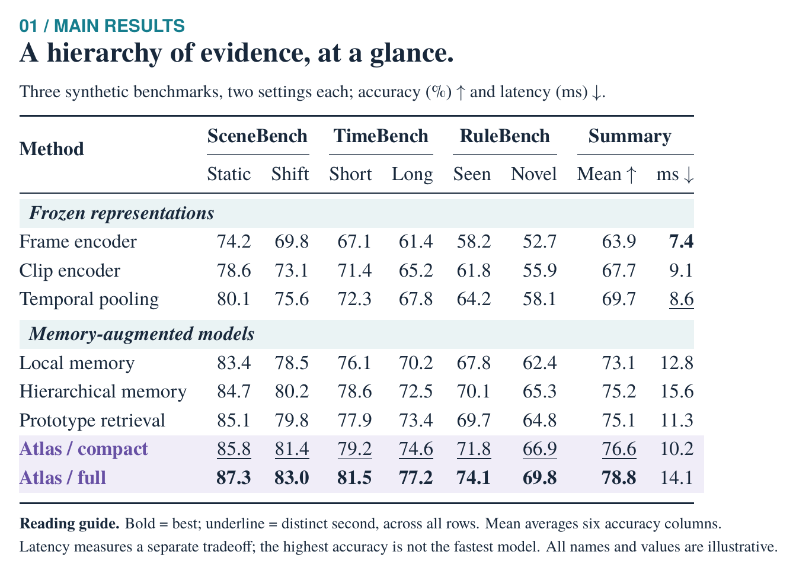
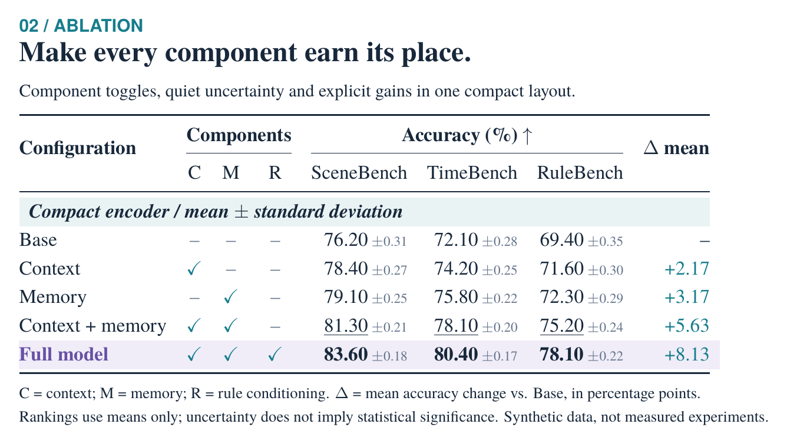
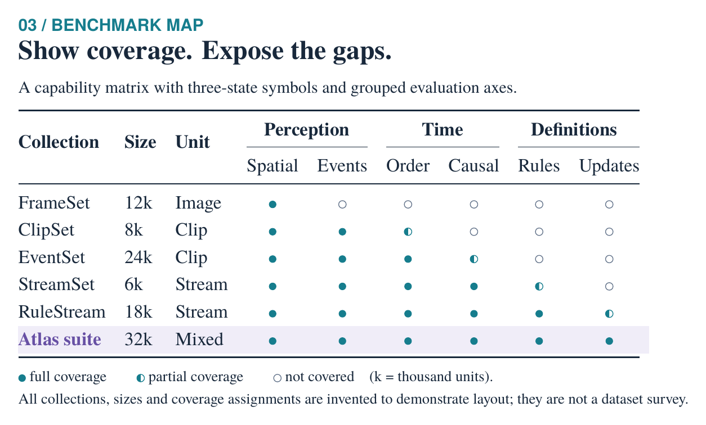
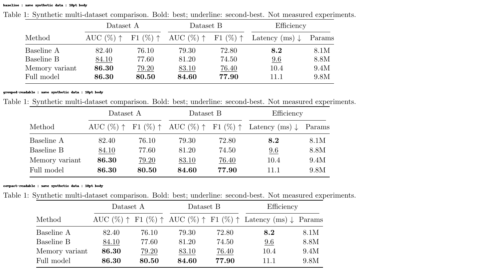

# Paper LaTeX Table Skill

**Give experimental results the clarity of a well-designed paper table.**

A Codex Skill for data-to-LaTeX generation, source-preserving refinement, screenshot reconstruction and reference-informed design reuse. Build a visual hierarchy with grouped headers, restrained color, deliberate typography and meaningful emphasis, while preserving the data and comparison contract.

[简体中文](README.md) · [Guide in Chinese](docs/guide.zh-CN.md) · [Skill contract](SKILL.md) · [Layout catalog](references/reference-catalog.md)

**Data → tables · Code + image → faithful reconstruction · Image → editable TeX · Examples → reusable design knowledge**

## See what a table can communicate

These previews are **compiled from the bundled editable LaTeX sources**. All model names, datasets, values and coverage assignments are original synthetic illustrations, not experimental results. Advanced layouts are agent-authored; the JSON generator does not automatically produce arbitrary table designs.

### 01 / Main results: dense, with a clear hierarchy



**Three benchmarks × two settings.** Bold-italic family bands organize the rows; a pale violet accent locates the featured methods. Best and distinct second-best values are marked across all comparable rows. Latency remains a separate lower-is-better tradeoff.

[Editable TeX](docs/examples/showcase/showcase-main.tex) · [Synthetic data](docs/examples/showcase/data.json)

### 02 / Ablation: make every component earn its place



Read **components → accuracy → mean gain** in one row. Smaller gray standard deviations keep the means legible; gains declare their baseline and percentage-point units. Ranking means does not establish significance.

[Editable TeX](docs/examples/showcase/showcase-ablation.tex) · [Synthetic data](docs/examples/showcase/data.json)

### 03 / Coverage: show the gaps as clearly as the strengths



Perception, time and definition axes share a **full / partial / absent** symbol vocabulary. Shape carries the meaning; color reinforces it. Sizes, evaluation units and the legend stay close to the table.

[Editable TeX](docs/examples/showcase/showcase-coverage.tex) · [Rebuild previews](docs/render_showcase.py)

<details>
<summary>More examples: same-data refinement and basic generation</summary>


[Before](docs/examples/refinement-before.tex) · [After](docs/examples/refinement-after.tex) · [Basic benchmark spec](docs/examples/benchmark.json) · [Basic ablation spec](docs/examples/ablation.json)

</details>

## Capabilities

| Capability | What it does |
| --- | --- |
| Table generation | Produce LaTeX tables from a JSON spec: `booktabs` rules, one grouped-header level, multiple datasets, ablation layouts. |
| Ranking & emphasis | Explicit higher/lower/none direction per column; **bold** best, <u>underline</u> distinct second best; shared marks for ties; missing values excluded; parameters unranked unless you ask. |
| Numeric fidelity | Explicit numeric source strings and precision are preserved in the data contract; no silent re-rounding. |
| Uncertainty display | Explicit mean/std or confidence intervals shown as configured; no significance inference is drawn for you. |
| Agent-assisted refinement | Complex or macro-heavy tables are refined via an agent-reviewed cell ledger, not blind LaTeX parsing. |
| Case retrieval | Deterministic local retrieval of similar public example cases. |
| Validation & preview | Static heuristic checks, TeX compilation and PDF rendering/inspection helpers. |
| Controlled learning | Records useful real examples or failure feedback as private candidates for later review. |

See [SKILL.md](SKILL.md) for the full contract.

## Installation

Easiest path: open Codex and ask —

> Install this local paper-latex-table-skill folder into my configured Codex skill directory, preserve existing skills, and verify discovery.

Manual installation (Windows PowerShell, run from this repository root):

```powershell
$source = (Resolve-Path .).Path
if (-not (Test-Path (Join-Path $source 'SKILL.md'))) { throw 'Run from the skill repository root.' }
$codexHome = if ($env:CODEX_HOME) { $env:CODEX_HOME } else { Join-Path $HOME '.codex' }
$destination = Join-Path $codexHome 'skills/paper-latex-table-skill'
if (Test-Path $destination) { throw 'Already installed; compare changes before updating.' }
New-Item -ItemType Directory -Force -Path (Split-Path $destination) | Out-Null
New-Item -ItemType Directory -Force -Path $destination | Out-Null
Get-ChildItem -LiteralPath $source -Force |
    Where-Object { $_.Name -notin @('.git', '.local', 'build', 'state', 'skill-state', '__pycache__') } |
    ForEach-Object { Copy-Item -LiteralPath $_.FullName -Destination $destination -Recurse }
```

After copying, confirm the skill is discovered and enabled in your Codex client; if the skill picker looks stale, restart Codex. Next turn, invoke `$paper-latex-table-skill`. These paths follow the current local Codex installation convention — adjust for your configured skill directory if it differs. User-directory installation normally requires no administrator privileges.

## Requirements

- Python 3.10+ (stdlib only for the helpers)
- An installed TeX engine (for `compile_table.py`)
- `pdftoppm`/Poppler (for PDF previews)
- Pillow, optionally, only if you regenerate the documentation preview images

## Quick start

Tell Codex what you want, naming the skill explicitly:

```text
$paper-latex-table-skill Create a grouped-header multi-dataset comparison from results/data.json.
$paper-latex-table-skill Improve the LaTeX in draft.tex to booktabs style without changing any data.
$paper-latex-table-skill Record the table in my_note.tex as a learning example; type is ablation, 9 columns, grouped headers.
$paper-latex-table-skill Check this table for overflow risk and verify the ranking marks are correct.
```

You can also drive the helpers directly from the repository root:

```text
python scripts/index_cases.py
python scripts/generate_table.py docs/examples/benchmark.json build/demo.tex
python scripts/validate_table.py build/demo.tex --spec docs/examples/benchmark.json
python scripts/compile_table.py build/demo.tex --output build/demo-compile
python scripts/inspect_render.py build/demo-compile/table-build.pdf --output build/demo-render
python scripts/retrieve_cases.py --columns 9 --type ablation --feature grouped_headers
```

Generation and compilation refuse existing outputs; use fresh filenames/directories when repeating these commands. Open the rendered PNGs to inspect the final table.

## Learning loop

The skill implements **controlled self-improvement**. When you supply a genuinely reusable example or report a real failure, `learning.py` records it as a pending private candidate with observed source hashes and evidence, stored outside the installed tree (default `$CODEX_HOME/skill-state/paper-latex-table-skill`, or `~/.codex/skill-state/...`), so it survives skill upgrades.

During authorized table tasks, useful observations can be captured as candidates. Stable promotion requires regression tests, compilation/visual/provenance review, explicit approval recorded with `rsi.py`, and manual integration. There is no background process, no autonomous rewrite of stable files, and no training of any model weights. Details: [references/continuous-learning.md](references/continuous-learning.md) and [rsi/improvement-policy.md](rsi/improvement-policy.md).

Record an example manually:

```text
python scripts/learning.py --kind case --source path/to/table.tex --reason "Reusable grouped-header pattern" --type ablation --columns 9 --feature grouped_headers
```

## Reproducibility & testing

Run the regression suite against your copy:

```text
python tests/test_tables.py
```

Regenerate the showcase (requires XeLaTeX, TeX Gyre fonts, Poppler and Pillow; choose a fresh build directory):

```text
python docs/render_showcase.py --build-root build/readme-showcase
```

## Scope & limits

- A passing compile is **not** a visual pass. Static checks are heuristic; test against the actual official conference template you are targeting before submission. Compatibility with any specific venue is not claimed.
- The public bundle contains eight original **synthetic** example cases. Private development references, if present, have separate provenance and redistribution rights and are excluded from the public export.
- Structured generation supports one grouped-header level. More complex refinement is agent-assisted and uses a reviewed ledger rather than a general LaTeX parser.
- Every preview figure in this README uses synthetic data.

## Publishing a clean copy

Local-only cases (`assets/cases/local/`) and private learning state must never be published. The root `.gitignore` excludes them. If `index_cases` output is absent after cloning, run `python scripts/index_cases.py`.

To export only public material:

```text
python scripts/export_public.py ../dist/paper-latex-table-skill.zip
```

Publish the extracted `paper-latex-table-skill` subfolder from that archive — it contains the README, figures, sources and public cases only.

## License

See [LICENSE](LICENSE). License selection is still pending; nothing here grants rights to relicense user-provided examples or local references.

## Reference reconstruction and image input

Version 1.2.0 adds source-preserving local reproduction, explicit typography profiles, image transcription ledgers and separate code/image authority. See [input routes](references/input-routes.md) and [learned layout catalog](references/reference-catalog.md). Local case images and reconstruction evidence stay inside `assets/cases/local/`, excluded from public export. The local gallery documents residual differences rather than claiming pixel identity.

See [three RSI loops](references/three-rsi-loops.md) for paired/image-only learning, evidence-bound episodes and reviewed design recombination. Local design reuse and stable rule promotion are separate.

### Design reuse: one data contract, three candidates



[Baseline TeX](docs/examples/design-reuse/baseline.tex) · [Grouped variant](docs/examples/design-reuse/grouped-readable.tex) · [Compact variant](docs/examples/design-reuse/compact-readable.tex). Synthetic data only; these are alternatives to inspect, not an automatically ranked aesthetic result.
