# Paper LaTeX Table Skill

**生成、精修与重建科研 LaTeX 表格，保留数据与比较语义。**

面向 Codex 的论文表格 Skill。输入实验数据、已有 TeX 或表格截图，交付可编辑源码、依赖说明与分层验证记录。参考驱动的排版覆盖分组主表、旋转表头、组件消融、并排子表和成对增益；新案例与修复经验可保存为待审阅的设计记录。

[English](README.en.md) · [中文教程](docs/guide.zh-CN.md) · [Skill 入口](SKILL.md) · [设计原则](references/table-design-principles.md)

<!-- LOCAL-ONLY:BEGIN -->
**本地私有参考速览：**[扩散主表](#diffusion-main) · [四面板消融](#representation-ablation) · [成对增益](#paired-generation) · [Guidance 对照](#guidance-comparison) · [算法框](#meanflow-algorithm) · [多模态宽表](#multimodal-main) · [数据配比](#data-mixture)
<!-- LOCAL-ONLY:END -->

## 表格示例

以下为实际编译的 LaTeX 表格，采用紧凑衬线字体、克制的横线，以及含义明确的灰色分组带或浅色重点行。caption 的位置、字重与层级按表格和子面板各自的说明角色处理，不强加统一模板，也不添加卡片式装饰。**所有名称、数值和覆盖关系均为合成示例，不代表真实实验结果。** 复杂布局由代理结合核对记录编写，不代表 JSON 生成器自动支持任意结构。

### 分组主表与旋转表头


类别用灰底斜体行区分，长指标名旋转排列；粗体和下划线按声明的比较范围标记最优与次优，浅绿只定位重点方法。

[TeX 源码](docs/examples/showcase/showcase-main.tex) · [原始合成数据](docs/examples/showcase/data.json)

### 并排消融子表


共享 caption，四个面板分别改变一个因素。灰底表示默认设置，粗体表示各面板内的列最优，两者含义独立。

[TeX 源码](docs/examples/showcase/showcase-sensitivity.tex) · [合成数据与逐格记录](docs/examples/showcase/academic-ledger.json)

### 成对方法比较与增益

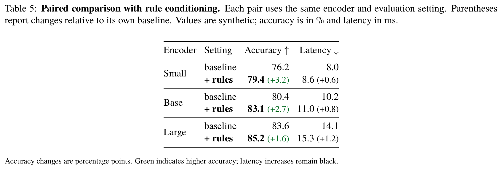

每个编码器的 baseline 与改进方法相邻排列。准确率增益按百分点计算；延迟增加保留为黑色开销，不用绿色暗示所有变化都有利。

[TeX 源码](docs/examples/showcase/showcase-paired.tex)

### 组件消融


保留均值精度与标准差，注明组件含义和增益基线。小号不确定性辅助阅读，不代替统计显著性分析。

[TeX 源码](docs/examples/showcase/showcase-ablation.tex)

### 数据集能力矩阵


实心、半实心、空心分别表达完整、部分和未覆盖，附带规模、单位与图例；灰度下也能区分。

[TeX 源码](docs/examples/showcase/showcase-coverage.tex) · [预览重建脚本](docs/render_showcase.py)

<!-- GALLERY:BEGIN -->

## 示例对照画廊

公开示例统计：公共索引共 20 对；本节直接显示 15 对。

另有 5 对公开示例已在上方“表格示例”小节直接显示，此处不重复：showcase-main, showcase-sensitivity, showcase-paired, showcase-ablation, showcase-coverage

<!-- LOCAL-ONLY:BEGIN -->

以下本地参考含私有图片与源码；公共导出会移除本标记块。

### 本地参考（私有） (18)

本地共 18 对私有参考，另有 20 对公开示例。

### diffusion-main

| 原图 | 重建 |
| --- | --- |
|  |  |

[重建 TeX](assets/cases/local/diffusion-main/table.tex) · [审阅记录](assets/cases/local/diffusion-main/STYLE-REVIEW.json) · [要点记录](assets/cases/local/diffusion-main/lesson.json)

结构：分组扩散基准主表，表下注释。可见匹配点：预训练双层表头、跨正文的语义竖线、灰色分组带和粗体 roman JiT 名称。原图中 latent 标签为常规斜体，pixel 标签为粗斜体；caption 三行，表格下方无底线。

### representation-ablation

| 原图 | 重建 |
| --- | --- |
|  |  |

[重建 TeX](assets/cases/local/representation-ablation/table.tex) · [审阅记录](assets/cases/local/representation-ablation/STYLE-REVIEW.json) · [要点记录](assets/cases/local/representation-ablation/lesson.json)

结构：共享说明加四个并排消融面板。可见匹配点：灰色默认行、局部加粗值和各面板短说明；原图共享 caption 五行，面板表格窄且居中、表体小于 caption。

### paired-generation

| 原图 | 重建 |
| --- | --- |
|  |  |

[重建 TeX](assets/cases/local/paired-generation/table.tex) · [审阅记录](assets/cases/local/paired-generation/STYLE-REVIEW.json) · [要点记录](assets/cases/local/paired-generation/lesson.json)

结构：按模型配对的 baseline/RCG 增益表。可见匹配点：多行方法标识、细分隔线、改进值粗体及括号内绿色增益；原图表格居中紧凑，caption 在表上方。

### guidance-comparison

| 原图 | 重建 |
| --- | --- |
|  |  |

[重建 TeX](assets/cases/local/guidance-comparison/table.tex) · [审阅记录](assets/cases/local/guidance-comparison/STYLE-REVIEW.json) · [要点记录](assets/cases/local/guidance-comparison/lesson.json)

结构：无/有 guidance 的双层指标表头。可见匹配点：类别人群整行灰字、块边界竖线和斜体组名；灰色表示人群，不表示排名。本例作为布局控制，不需无证据的风格改动。

### meanflow-algorithm

| 原图 | 重建 |
| --- | --- |
|  |  |

[重建 TeX](assets/cases/local/meanflow-algorithm/table.tex) · [审阅记录](assets/cases/local/meanflow-algorithm/STYLE-REVIEW.json) · [要点记录](assets/cases/local/meanflow-algorithm/lesson.json)

结构：带标题、注释和语法着色的算法伪代码。可见匹配点：窄横线、青色注释、洋红关键字/可调用项；函数名不加下划线，等号为黑色，Note 正文为小号常规衬线字。

### multimodal-main

| 原图 | 重建 |
| --- | --- |
|  |  |

[重建 TeX](assets/cases/local/multimodal-main/table.tex) · [审阅记录](assets/cases/local/multimodal-main/STYLE-REVIEW.json) · [要点记录](assets/cases/local/multimodal-main/lesson.json)

结构：视频/图像指标分块的宽主表。可见匹配点：65° 旋转表头、分组底色、浅绿目标行及独立的细分隔线；缩短表头应匹配字号与间距，不改变角度。

### data-mixture

| 原图 | 重建 |
| --- | --- |
|  |  |

[重建 TeX](assets/cases/local/data-mixture/table.tex) · [审阅记录](assets/cases/local/data-mixture/STYLE-REVIEW.json) · [要点记录](assets/cases/local/data-mixture/lesson.json)

结构：图像与视频指标分块的数据配比表。可见匹配点：旋转表头、斜体类别带、竖向块边界和浅绿 Full Mix 行；Full Mix 的标签与视频单元格加粗，图像单元格保持常规；baseline 数字字形倾斜度不确定，不据此设定统一规则。

<!-- LOCAL-ONLY:END -->

### 公开示例 (15)

### 组件消融 (结构化合成示例)

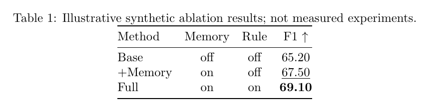

[TeX 源码](assets/cases/public/ablation/table.tex)

### 分组基准比较 (结构化合成示例)

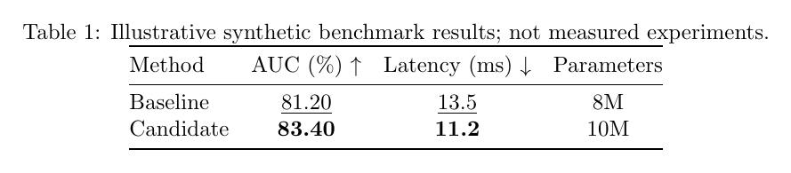

[TeX 源码](assets/cases/public/benchmark/table.tex)

### 跨数据集比较 (结构化合成示例)

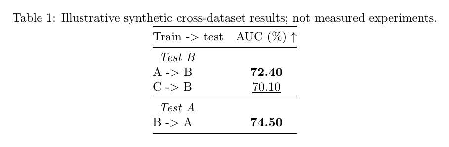

[TeX 源码](assets/cases/public/cross-dataset/table.tex)

### 小数点对齐 (结构化合成示例)

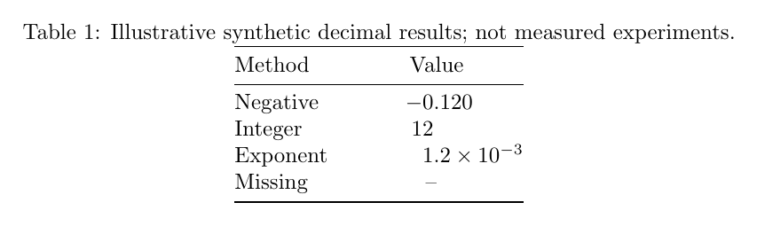

[TeX 源码](assets/cases/public/decimal/table.tex)

### 多数据集分组表头 (结构化合成示例)

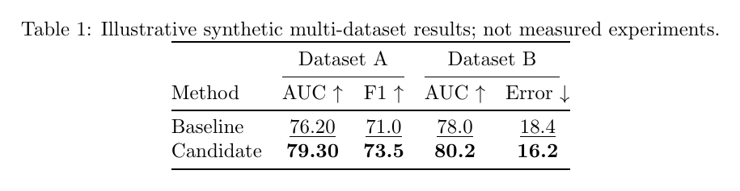

[TeX 源码](assets/cases/public/multi-dataset/table.tex)

### 并列与缺失值 (结构化合成示例)

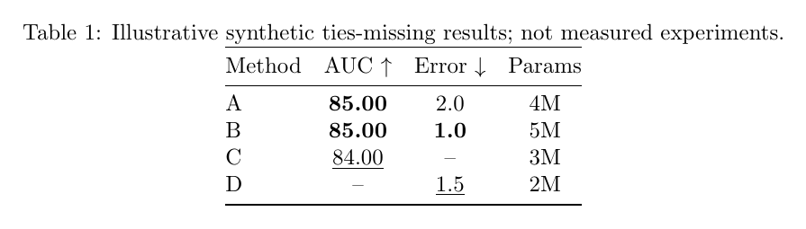

[TeX 源码](assets/cases/public/ties-missing/table.tex)

### 均值与不确定性 (结构化合成示例)

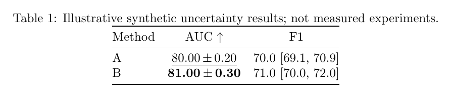

[TeX 源码](assets/cases/public/uncertainty/table.tex)

### 宽基准表 (结构化合成示例)

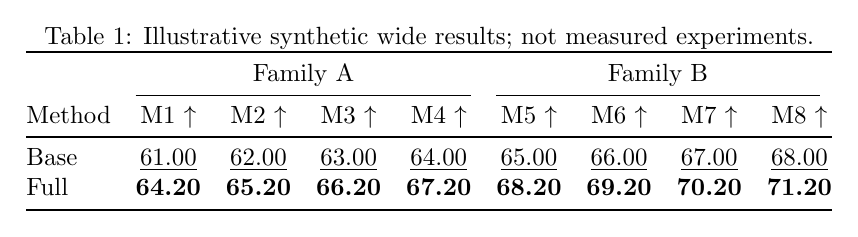

[TeX 源码](assets/cases/public/wide/table.tex)

### 基础基准表示例 (文档合成示例)


[TeX 源码](docs/examples/benchmark.tex)

### 基础消融表示例 (文档合成示例)


[TeX 源码](docs/examples/ablation.tex)

### 精修前：完整网格 (精修合成示例)

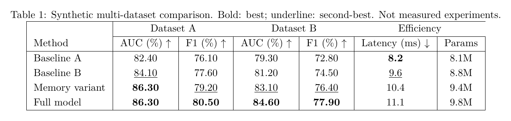

[TeX 源码](docs/examples/refinement-before.tex)

### 精修后：分组横线 (精修合成示例)

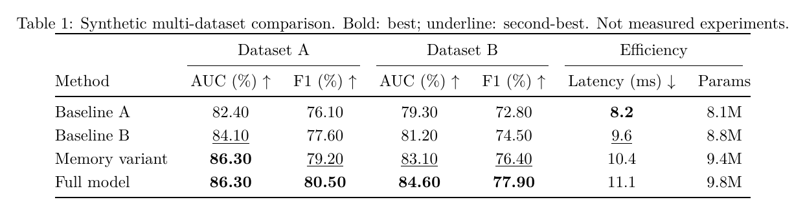

[TeX 源码](docs/examples/refinement-after.tex)

### 复用基线 (设计复用合成示例)


[TeX 源码](docs/examples/design-reuse/baseline.tex)

### 分组复用方案 (设计复用合成示例)

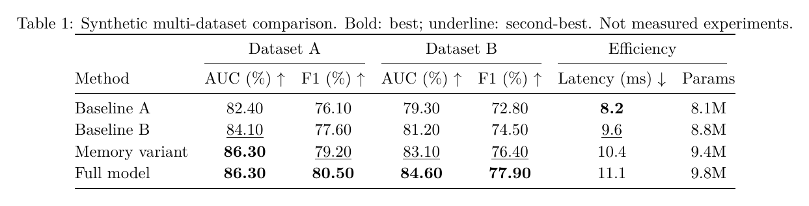

[TeX 源码](docs/examples/design-reuse/grouped-readable.tex)

### 紧凑复用方案 (设计复用合成示例)

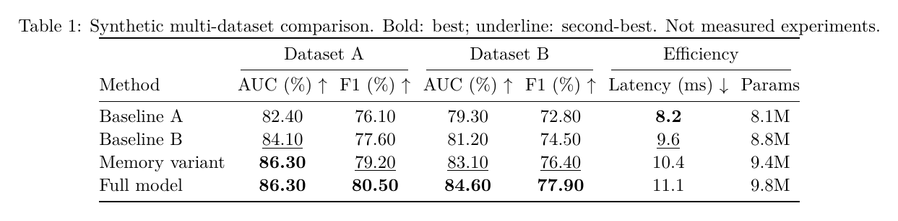

[TeX 源码](docs/examples/design-reuse/compact-readable.tex)

<!-- LOCAL-ONLY:BEGIN -->

以下本地参考含私有图片与源码；公共导出会移除本标记块。

### 其余本地参考（11）

### ablation_table-example1

| 原图 | 重建 |
| --- | --- |
|  |  |

[原始 TeX](assets/cases/local/ablation_table-example1/table.tex) · [重建 TeX](assets/cases/local/ablation_table-example1/reproduction/image-style/run-style-3/build/table-build.tex) · [审阅记录](assets/cases/local/ablation_table-example1/reproduction/REVIEW.md)

保留源码的样式分支；源码/图片差异仍单独记录

### ablation_table-example2

| 原图 | 重建 |
| --- | --- |
|  |  |

[原始 TeX](assets/cases/local/ablation_table-example2/table.tex) · [重建 TeX](assets/cases/local/ablation_table-example2/reproduction/image-style/run-style-4/build/table-build.tex) · [审阅记录](assets/cases/local/ablation_table-example2/reproduction/REVIEW.md)

保留源码的样式分支；源码/图片差异仍单独记录

### dataset_benchmark_table

| 原图 | 重建 |
| --- | --- |
|  |  |

[原始 TeX](assets/cases/local/dataset_benchmark_table/table.tex) · [重建 TeX](assets/cases/local/dataset_benchmark_table/reproduction/image-style/run-style-3/build/table-build.tex) · [审阅记录](assets/cases/local/dataset_benchmark_table/reproduction/REVIEW.md)

保留源码的样式分支；源码/图片差异仍单独记录

### main_table-example1

| 原图 | 重建 |
| --- | --- |
|  |  |

[原始 TeX](assets/cases/local/main_table-example1/table.tex) · [重建 TeX](assets/cases/local/main_table-example1/reproduction/image-style/run-style-3/build/table-build.tex) · [审阅记录](assets/cases/local/main_table-example1/reproduction/REVIEW.md)

保留源码的样式分支；源码/图片差异仍单独记录

### main_table-example2

| 原图 | 重建 |
| --- | --- |
|  |  |

[原始 TeX](assets/cases/local/main_table-example2/table.tex) · [重建 TeX](assets/cases/local/main_table-example2/reproduction/image-style/run-style-4/build/table-build.tex) · [审阅记录](assets/cases/local/main_table-example2/reproduction/REVIEW.md)

保留源码的样式分支；源码/图片差异仍单独记录

### main_table-example3

| 原图 | 重建 |
| --- | --- |
|  |  |

[原始 TeX](assets/cases/local/main_table-example3/table.tex) · [重建 TeX](assets/cases/local/main_table-example3/reproduction/image-style/run-style-3/build/table-build.tex) · [审阅记录](assets/cases/local/main_table-example3/reproduction/REVIEW.md)

保留源码的样式分支；源码/图片差异仍单独记录

### main_table-example4

| 原图 | 重建 |
| --- | --- |
|  |  |

[原始 TeX](assets/cases/local/main_table-example4/table.tex) · [重建 TeX](assets/cases/local/main_table-example4/reproduction/image-style/run-style-3/build/table-build.tex) · [审阅记录](assets/cases/local/main_table-example4/reproduction/REVIEW.md)

保留源码的样式分支；源码/图片差异仍单独记录

### others-example1

| 原图 | 重建 |
| --- | --- |
|  |  |

[原始 TeX](assets/cases/local/others-example1/table.tex) · [重建 TeX](assets/cases/local/others-example1/reproduction/image-style/run-style-3/build/table-build.tex) · [审阅记录](assets/cases/local/others-example1/reproduction/REVIEW.md)

保留源码的样式分支；源码/图片差异仍单独记录

### others-example2

| 原图 | 重建 |
| --- | --- |
|  |  |

[原始 TeX](assets/cases/local/others-example2/table.tex) · [重建 TeX](assets/cases/local/others-example2/reproduction/image-style/run-style-3/build/table-build.tex) · [审阅记录](assets/cases/local/others-example2/reproduction/REVIEW.md)

保留源码的样式分支；源码/图片差异仍单独记录

### others-example3

| 原图 | 重建 |
| --- | --- |
|  |  |

[原始 TeX](assets/cases/local/others-example3/table.tex) · [重建 TeX](assets/cases/local/others-example3/reproduction/image-style/run-style-3/build/table-build.tex) · [审阅记录](assets/cases/local/others-example3/reproduction/REVIEW.md)

保留源码的样式分支；源码/图片差异仍单独记录

### main_table-example4-image-23

| 原图 | 重建 |
| --- | --- |
|  |  |

[重建 TeX](assets/cases/local/main_table-example4/reproduction/image-only/styled-document-v2.tex)

23 列图片分支，与 25 列代码分支分开保存

<!-- LOCAL-ONLY:END -->

<!-- GALLERY:END -->

## 核心特点

| 特点 | 工作方式 |
| --- | --- |
| 参考驱动排版 | 先匹配论文参考的 caption、密度、字体角色、表头和强调，再适配数据；不添加海报式装饰。 |
| 数据保真 | 核对单元格身份、数值字符串、精度、不确定性和引用；代码与图片冲突时保留独立版本。 |
| 有依据的强调 | 显式指定指标方向、比较范围和并列规则；默认行、重点方法与最优值分别处理。 |
| 可编辑重建 | 恢复宏与依赖；图片先逐格转写，模糊值保留 [?]，不猜数字。 |
| 持续积累 | 保存私有待审案例和失败修复记录，供后续检索；稳定规则另经回归与审核。 |
| 分层验证 | 分别报告数据核对、静态检查、编译与渲染审阅，保留源码和证据。 |

## 三种输入方式

| 输入 | 工作方式 | 交付 |
| --- | --- | --- |
| 代码 + 图片 | 对照代码与原图，恢复宏和依赖，检查行列、数值、字体、粗斜体及强调标记 | TeX、依赖说明、冲突记录、实际编译与原图对比 |
| 仅代码 / 数据 | 保留原始字符串与精度，按目标版心生成或精修 | 可编辑 TeX、数据核对记录、PDF/PNG |
| 仅图片 | 先建立逐格转写记录；模糊字符保留 `[?]`，再重建表格 | TeX、图片哈希、转写状态及待确认清单 |

代码与图片可能来自不同版本。默认保留代码数据；如果需要按图复现，建立独立版本，不用修改数字来掩盖冲突。辅助脚本不是 OCR，也不能凭图片确认实验真实性。

## 已学习的布局

本地完整版包含 **17 个用户参考**：10 个"代码 + 图片"成对案例与 7 个仅图片参考；连同 main_table-example4 独立的 23 列图片分支，构成 **18 对本地 figure/TeX 对照**。源码保真编译对照适用于有原始 TeX 的成对案例；仅图片案例为手工转写与重建，不属于源码保真复现。原始 23 个文件的哈希核对仅覆盖最初的 10 个成对案例，不表示其余文件均已核验。17 个参考的全部细节见[参考示例明细](references/example-details.md)。公开画廊另有 **20 对合成示例**，由 8 个结构化案例与 showcase / basic / refinement / reuse 变体组成。

| 布局 | 主要设计 | 关注细节 |
| --- | --- | --- |
| Few-shot 组件消融 | 9 列、3 个组件、两种 backbone、成对 shot 列 | 均值 ± 标准差、粗体最优行、斜体分组、增益箭头 |
| 多数据集组件消融 | 11 列、Global/Local 分组、淡色区块 | 粗体/下划线作用域、紫色完整方法、细字号注释 |
| 数据集能力矩阵 | 14 列、分层表头、覆盖圆点 | 实心/半实心/空心、图例与字号比例 |
| 空间能力主表 | 12 列、旋转列名、3 类指标 | Rank 原值、分组斜体、深浅灰强调 |
| Omni 模型主表 | 15 列、类别与难度分组 | 分组粗斜体、品牌图标、参数字符串 |
| 多领域工具主表 | 13 列、能力图标、标准差、双 Δ 列 | 小号灰色不确定性、下标、平均行 |
| Zero-shot 综合表 | 25 列源码 / 23 列图片 | 旋转彩色表头、平均列、版本冲突隔离 |
| 编码器比较 | 8 列、中心化/全局/局部分组 | 灰色基线、粗体正文、不同增益基准 |
| 联邦数据划分 | 6 列、Local/Global 成对比较 | 多行 setting、希腊字母、百分点变化 |
| 模型资源目录 | 5 列、按家族分组、长 URL | 粗斜体家族名、正文粗体、可编辑链接 |

详细经验见[参考目录](references/reference-catalog.md)。原始参考材料的再分发权尚未确认，因此本地原图、复现图及逐案审核放在 `assets/cases/local/GALLERY.md`；公开 GitHub 包不包含该私有目录。公开演示预览使用合成数据；可选私有参考用于复现用户提供的来源，其内容主张未经独立核实。本地画廊展示的是实际重建与残差，不宣称像素完全一致。

## 安装到 Codex

在 Codex 中打开本仓库，发送：

```text
请将当前 paper-latex-table-skill 安装到我已配置的 Codex skills 目录。
如已存在，请先比较和备份，保留已有学习记录，安装后验证技能可发现。
```

手动安装（Windows PowerShell；从包含 SKILL.md 的仓库根目录执行）：

```powershell
$skillSource = (Resolve-Path .).Path
if (-not (Test-Path (Join-Path $skillSource 'SKILL.md'))) { throw '请在技能仓库根目录执行' }
$skillHome = if ($env:CODEX_HOME) { $env:CODEX_HOME } else { Join-Path $HOME '.codex' }
$skillTarget = Join-Path $skillHome 'skills/paper-latex-table-skill'
if (Test-Path $skillTarget) { throw '目标已存在，请先比较并备份再更新' }
New-Item -ItemType Directory -Force -Path $skillTarget | Out-Null
Get-ChildItem -LiteralPath $skillSource -Force |
    Where-Object { $_.Name -notin @('.git', '.local', 'build', 'state', 'skill-state', '__pycache__') } |
    ForEach-Object { Copy-Item -LiteralPath $_.FullName -Destination $skillTarget -Recurse }
```

安装后检查 Codex 的技能列表。若列表未刷新，重启客户端后在新一轮对话中输入 `$paper-latex-table-skill`。无需启用 OpenCode；它仅用于开发评审。

## 使用示例

```text
$paper-latex-table-skill 用 results.json 生成双栏论文通栏表；accuracy 越高越好，latency 越低越好。
$paper-latex-table-skill 按 figure.png 复现 table.tex，对齐字体、字号、粗体、斜体、下划线与间距，保留全部数值。
$paper-latex-table-skill 只有这张截图，请先逐格转写，再重建可编辑 LaTeX；看不清的值不要猜。
$paper-latex-table-skill 学习这份新表格，保存源代码/图片、设计参数与核对记录，作为待审阅参考。
```

命令行（输出应使用新文件/目录）：

```text
python scripts/index_cases.py
python scripts/generate_table.py docs/examples/benchmark.json build/demo.tex
python scripts/validate_table.py build/demo.tex --spec docs/examples/benchmark.json
python scripts/compile_table.py build/demo.tex --output build/demo-compile
python scripts/inspect_render.py build/demo-compile/table-build.pdf --output build/demo-render
python scripts/retrieve_cases.py --columns 9 --type ablation --feature grouped_headers
```

本地参考复现与图片转写的命令、格式和依赖见[输入流程](references/input-routes.md)。JSON 生成器支持一层分组表头；复杂 multirow、深层表头和专用宏由代理结合核对记录编写。

## 持续学习

新案例或真实修复经验会保存为私有 pending 记录，默认位于 `$CODEX_HOME/skill-state/paper-latex-table-skill`，不随技能更新覆盖。后续相关任务可以检索这些记录，复用经过核对的布局与修复方法。

稳定规则、脚本和案例晋升需经过回归、来源检查、实际渲染审阅及明确批准。这里的“自我进化”是可追溯的经验积累与受控改进，不是模型权重训练或后台自行改写。见[学习流程](references/continuous-learning.md)和[改进政策](rsi/improvement-policy.md)。

## 依赖与验证

- Python 3.10+；核心生成、校验、转写脚本仅用标准库。
- TeX 引擎与所需宏包；本地恢复案例使用 XeLaTeX、fontspec、TikZ 等。
- Poppler `pdftoppm` 用于 PDF 转 PNG；Pillow 为对比图/文档预览的可选依赖。
- 字体对齐分支优先使用本机 Times New Roman，缺少时回退 TeX Gyre Termes；截图无法提供确切字体元数据，推断和替代会写入记录。

数据核对、编译成功、视觉对应与投稿尺寸可读性分别报告。编译成功不等于视觉通过，也不代表符合任一会议官方模板。

## 公开打包

```text
python scripts/export_public.py .local/releases/paper-latex-table-skill-1.2.0.zip
```

导出排除私有参考、构建日志、学习状态、Git 历史与内部备份，保留公开示例、README 图片及可运行工具。项目许可证状态见 [LICENSE](LICENSE)；第三方参考不会自动继承项目许可。

README 目录与原图/复现画廊的组织参考了 [Trae1ounG/paper-plot-skills](https://github.com/Trae1ounG/paper-plot-skills)。开发中使用本机 OpenCode API 完成了一份文档与流程评审；运行本技能不依赖它。

## 三条 RSI 学习与复用流程

| 模式 | 如何学习 | 如何复用 |
| --- | --- | --- |
| Code + Figure | 原件快照 → 行列/数值/样式冲突核对 → 宏与字体恢复 → 编译对比 | 从已审阅版本提取布局参数；代码版与图片版分开 |
| Figure Only | 逐格转写 → 模糊值 `[?]` → 可编辑 TeX → 字体与粗斜体对照 | 保存图片哈希、转写与恢复经验；未确认值阻止晋升 |
| 设计复用 | 检索相近案例/历史失败 → 分解设计角色 → 基线 + 最多两个组合候选 | 同数据、同最小字号下比较；只保留经核对的参数组合 |

新增 `rsi_episode.py` 记录实际学习过程，`compose_designs.py` 生成并核对设计候选。当前自动组合范围为列间距、行距、分组斜体/粗斜体；复杂表头、配色和线型由 Codex 基于参考与核对记录编写。日常复用不需额外的全局升级批准；稳定规则与脚本晋升单独管理。详见[三模式教程与命令](references/three-rsi-loops.md)。

### 设计复用：一份数据，三种候选


[Baseline TeX](docs/examples/design-reuse/baseline.tex) · [Grouped variant](docs/examples/design-reuse/grouped-readable.tex) · [Compact variant](docs/examples/design-reuse/compact-readable.tex). 仅使用合成数据；候选用于人工比较，不代表自动审美排名。
