# Paper LaTeX Table Skill

**生成、精修与重建科研 LaTeX 表格，保留数据与比较语义。**

面向 Codex 的论文表格 Skill。输入实验数据、已有 TeX 或表格截图，交付可编辑源码、依赖说明与分层验证记录。参考驱动的排版覆盖分组主表、旋转表头、组件消融、并排子表和成对增益；新案例与修复经验可保存为待审阅的设计记录。

[English](README.en.md) · [中文教程](docs/guide.zh-CN.md) · [Skill 入口](SKILL.md) · [设计原则](references/table-design-principles.md)

## 表格示例

### Benchmark Comparison

#### 公开基准比较

**原图:**

未提供原图；此项为项目编写的合成示例。

**原始 TeX:**

未提供原始 TeX

**Skill 重建结果:**

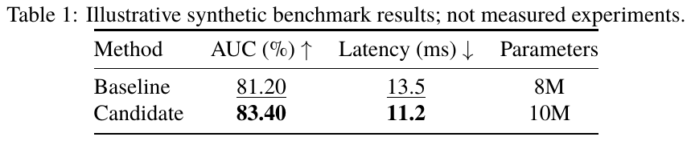

**重建 TeX:**

[重建 TeX](examples/public/public-benchmark/reconstruction.tex)

#### 公开宽表比较

**原图:**

未提供原图；此项为项目编写的合成示例。

**原始 TeX:**

未提供原始 TeX

**Skill 重建结果:**

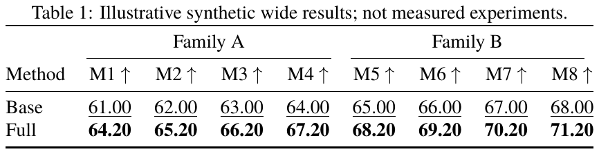

**重建 TeX:**

[重建 TeX](examples/public/public-wide/reconstruction.tex)

#### 主表示例

**原图:**

未提供原图；此项为项目编写的合成示例。

**原始 TeX:**

未提供原始 TeX

**Skill 重建结果:**

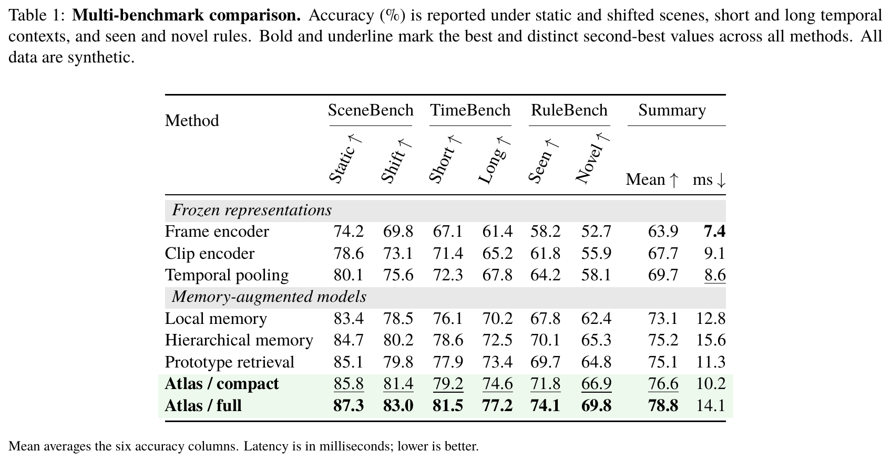

**重建 TeX:**

[重建 TeX](examples/public/showcase-main/reconstruction.tex)

#### 成对生成示例

**原图:**

未提供原图；此项为项目编写的合成示例。

**原始 TeX:**

未提供原始 TeX

**Skill 重建结果:**


**重建 TeX:**

[重建 TeX](examples/public/showcase-paired/reconstruction.tex)

<!-- LOCAL-ONLY:BEGIN -->
#### 主表示例 1

**原图:**

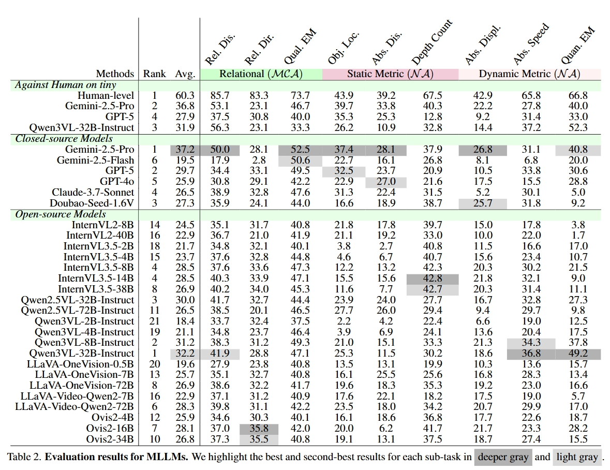

**原始 TeX:**

[原始 TeX](examples/references/main_table-example1/original.tex)

**Skill 重建结果:**

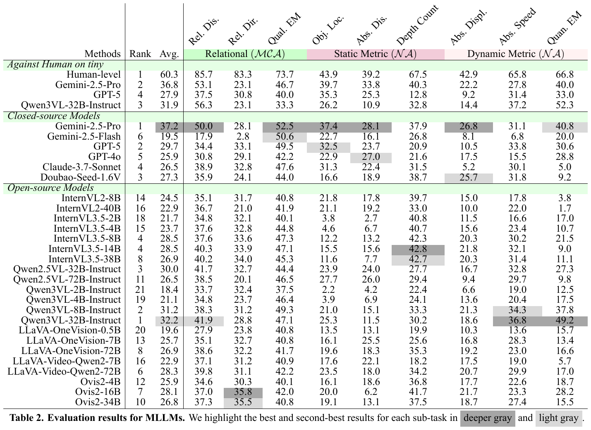

**重建 TeX:**

[重建 TeX](examples/references/main_table-example1/reconstruction.tex)

<!-- LOCAL-ONLY:END -->

<!-- LOCAL-ONLY:BEGIN -->
#### 主表示例 2

**原图:**

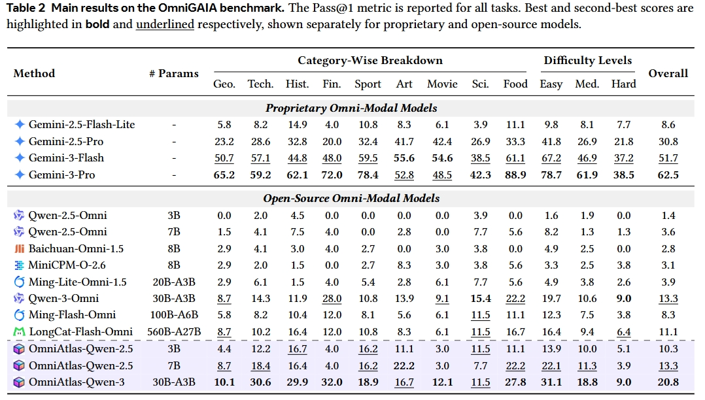

**原始 TeX:**

[原始 TeX](examples/references/main_table-example2/original.tex)

**Skill 重建结果:**

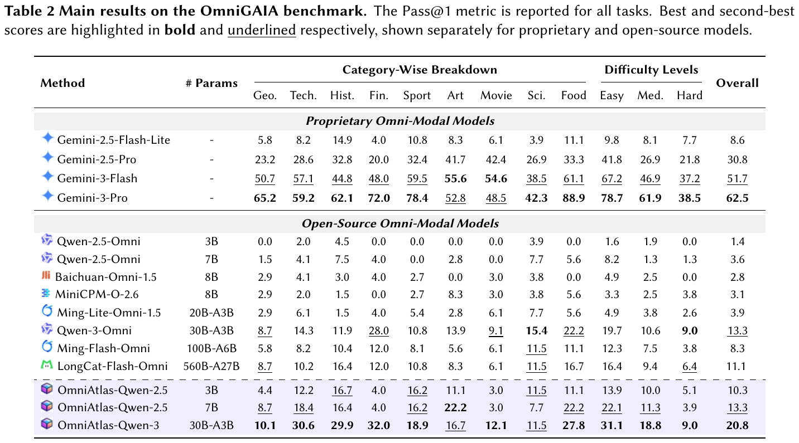

**重建 TeX:**

[重建 TeX](examples/references/main_table-example2/reconstruction.tex)

<!-- LOCAL-ONLY:END -->

<!-- LOCAL-ONLY:BEGIN -->
#### 主表示例 3

**原图:**

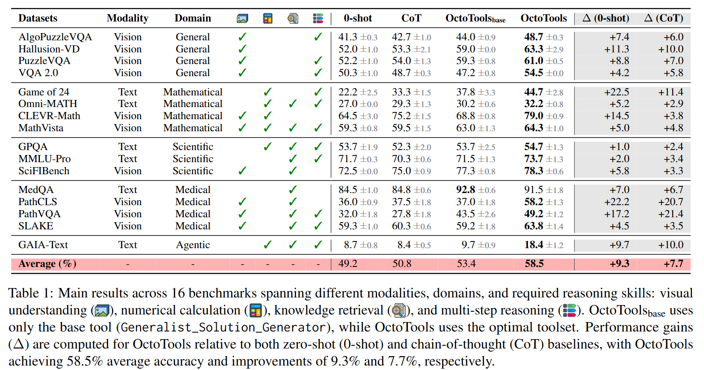

**原始 TeX:**

[原始 TeX](examples/references/main_table-example3/original.tex)

**Skill 重建结果:**

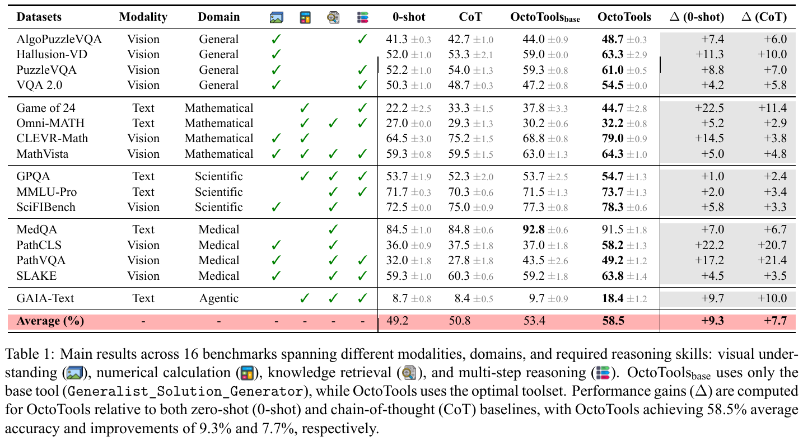

**重建 TeX:**

[重建 TeX](examples/references/main_table-example3/reconstruction.tex)

<!-- LOCAL-ONLY:END -->

<!-- LOCAL-ONLY:BEGIN -->
#### 主表：25 列源文件分支

**原图:**

未提供与此 25 列源码分支匹配的原图；保留的截图属于下方独立的 Image-23 图像分支。

**原始 TeX:**

[原始 TeX](examples/references/main_table-example4/original.tex)

**Skill 重建结果:**

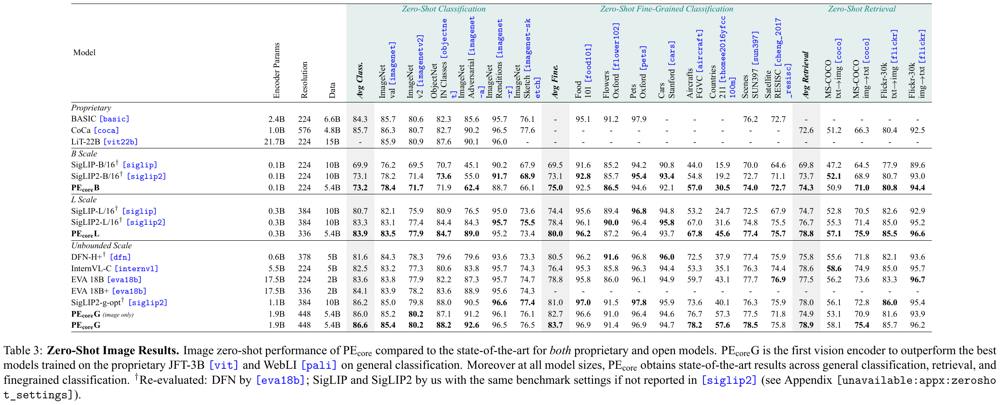

**重建 TeX:**

[重建 TeX](examples/references/main_table-example4/reconstruction.tex)

Provenance: Unresolved citation keys: aircraft, basic, cars, cheng_2017_resisc, coca, coco, dfn, eva18b, flickr, flower102, food101, imagenet, imagenet-a, imagenet-r, imagenet-sketch, imagenetv2, internvl, objectnet, pali, pets, siglip, siglip2, sun397, thomee2016yfcc100m, vit, vit22b; Unresolved cross-reference labels: appx:zeroshot_settings; Source TeX is from the 25-column branch; image-23 is a separate image branch and must not be represented as its matching source image.

<!-- LOCAL-ONLY:END -->

<!-- LOCAL-ONLY:BEGIN -->
#### 主表：Image-23 图像分支

**原图:**

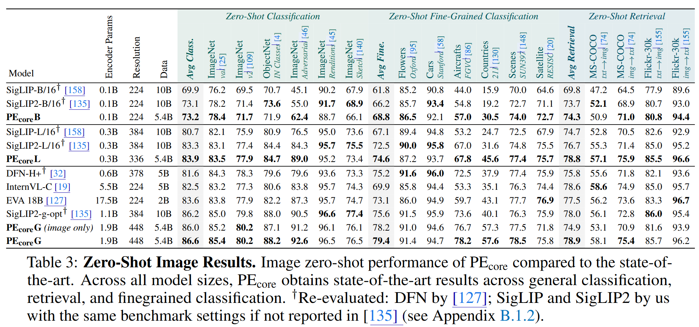

**原始 TeX:**

未提供原始 TeX

**Skill 重建结果:**

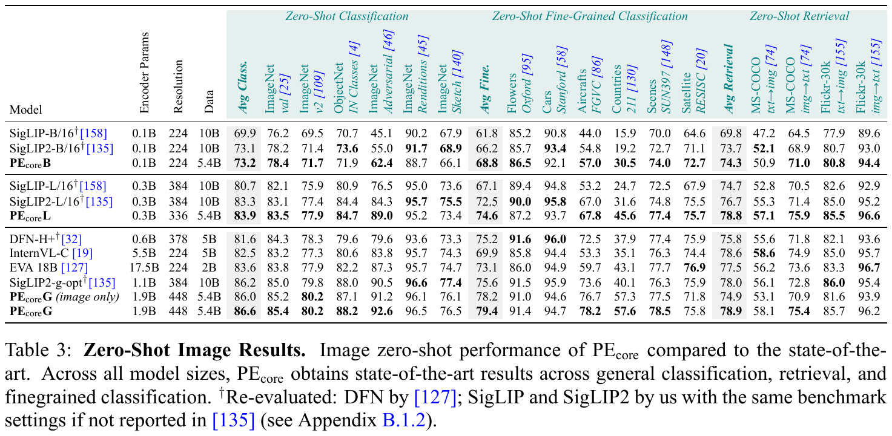

**重建 TeX:**

[重建 TeX](examples/references/main_table-example4-image-23/reconstruction.tex)

来源说明：此处的 23 列指完整表格列数，包含模型、参数量、分辨率及数据量等说明列；与上方 25 列源码分支分别保留。它们也不同于 Cambrian-S 表中的 13 个基准指标列。

<!-- LOCAL-ONLY:END -->

<!-- LOCAL-ONLY:BEGIN -->
#### 扩散模型基准比较

**原图:**

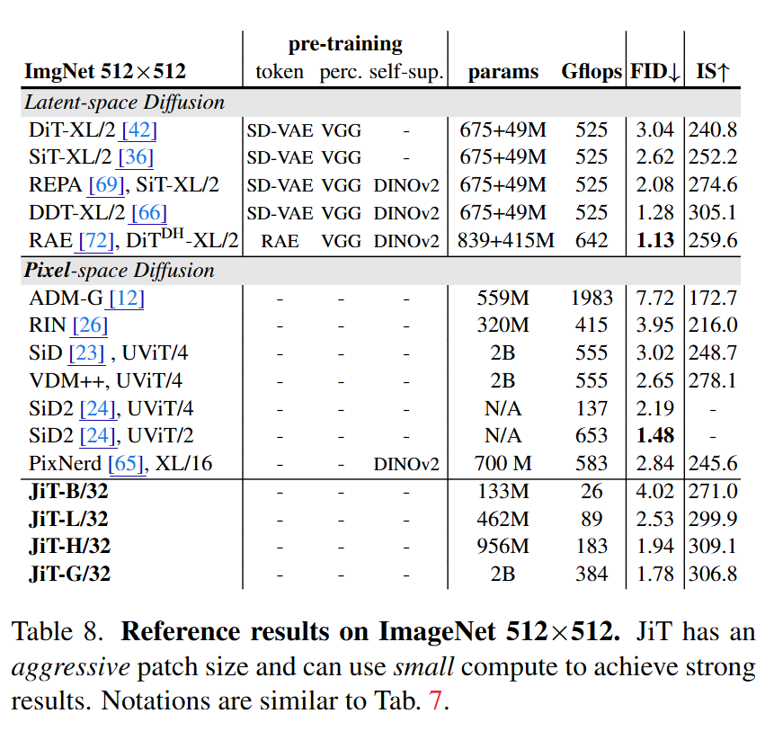

**原始 TeX:**

未提供原始 TeX

**Skill 重建结果:**

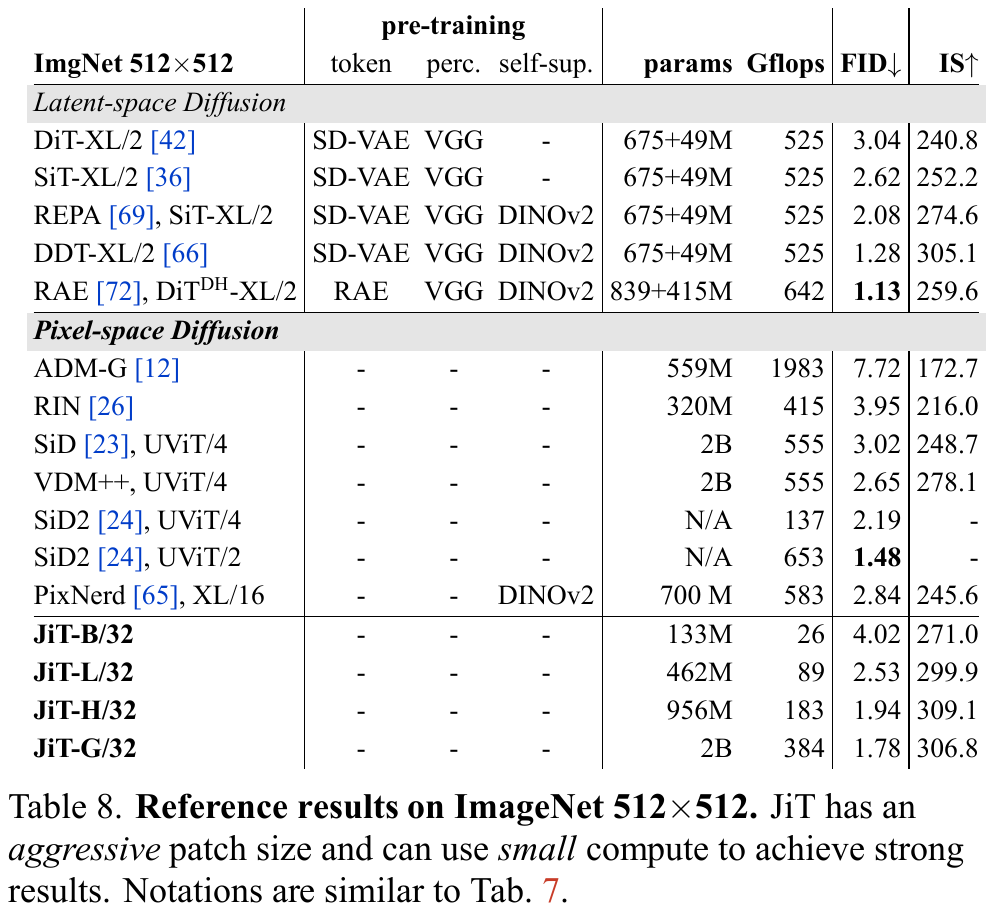

**重建 TeX:**

[重建 TeX](examples/references/diffusion-main/reconstruction.tex)

<!-- LOCAL-ONLY:END -->

<!-- LOCAL-ONLY:BEGIN -->
#### 成对生成比较

**原图:**

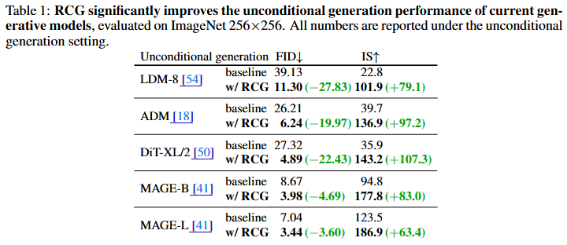

**原始 TeX:**

未提供原始 TeX

**Skill 重建结果:**

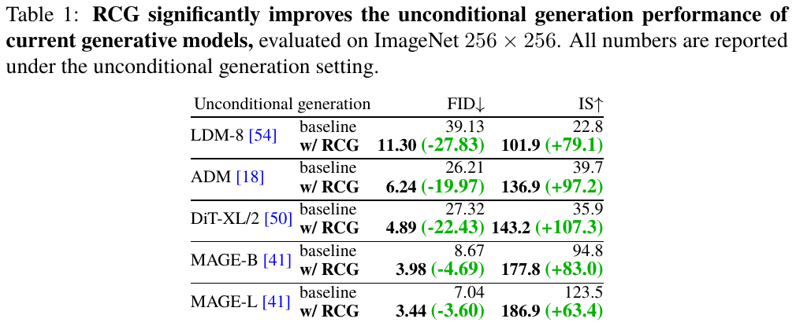

**重建 TeX:**

[重建 TeX](examples/references/paired-generation/reconstruction.tex)

<!-- LOCAL-ONLY:END -->

<!-- LOCAL-ONLY:BEGIN -->
#### 引导方法比较

**原图:**

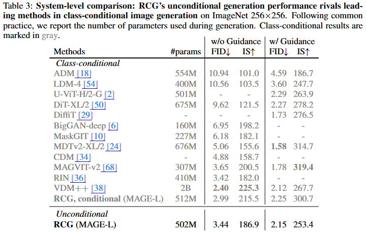

**原始 TeX:**

未提供原始 TeX

**Skill 重建结果:**

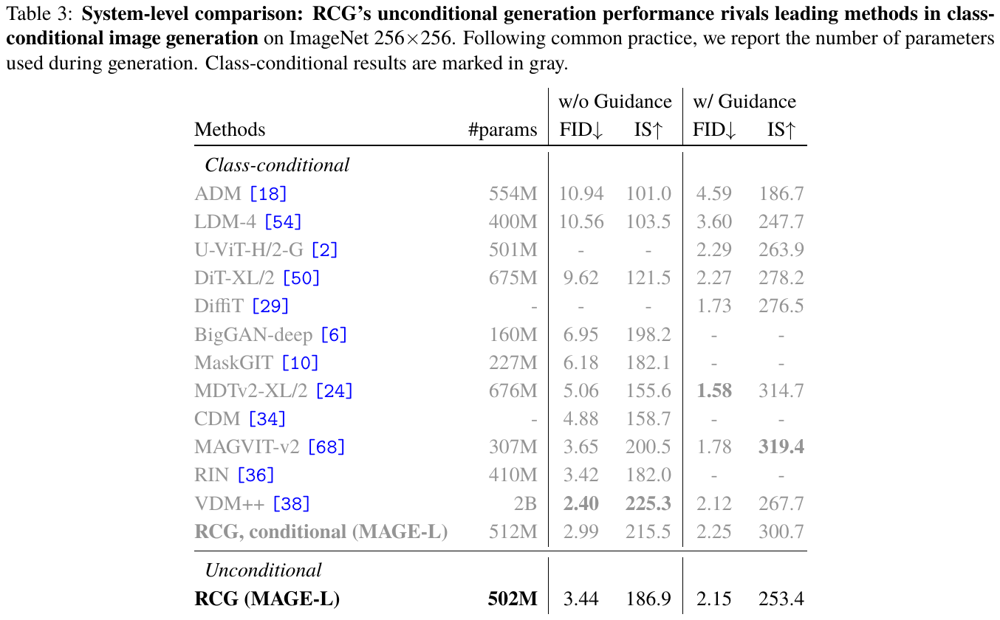

**重建 TeX:**

[重建 TeX](examples/references/guidance-comparison/reconstruction.tex)

Provenance: Unresolved citation keys: 10, 18, 2, 24, 29, 34, 36, 38, 50, 54, 6, 68

<!-- LOCAL-ONLY:END -->

<!-- LOCAL-ONLY:BEGIN -->
#### 多模态基准比较

**原图:**

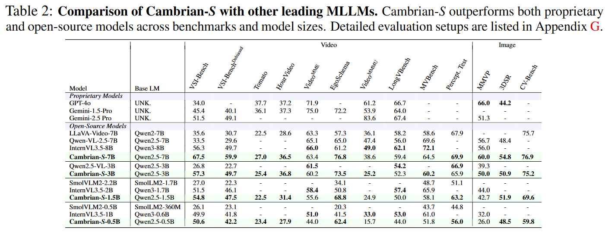

**原始 TeX:**

未提供原始 TeX

**Skill 重建结果:**

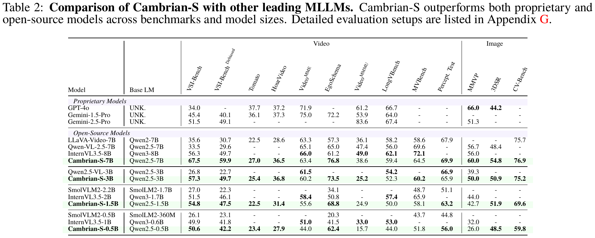

**重建 TeX:**

[重建 TeX](examples/references/multimodal-main/reconstruction.tex)

<!-- LOCAL-ONLY:END -->

### Ablation Study

#### 公开消融示例

**原图:**

未提供原图；此项为项目编写的合成示例。

**原始 TeX:**

未提供原始 TeX

**Skill 重建结果:**

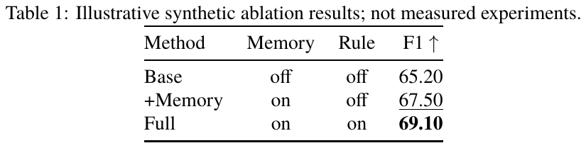

**重建 TeX:**

[重建 TeX](examples/public/public-ablation/reconstruction.tex)

#### 敏感性分析示例

**原图:**

未提供原图；此项为项目编写的合成示例。

**原始 TeX:**

未提供原始 TeX

**Skill 重建结果:**

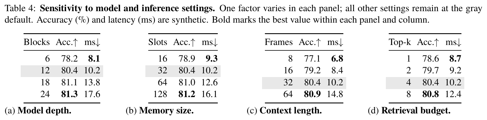

**重建 TeX:**

[重建 TeX](examples/public/showcase-sensitivity/reconstruction.tex)

#### 消融研究示例

**原图:**

未提供原图；此项为项目编写的合成示例。

**原始 TeX:**

未提供原始 TeX

**Skill 重建结果:**


**重建 TeX:**

[重建 TeX](examples/public/showcase-ablation/reconstruction.tex)

#### 基础消融示例

**原图:**

未提供原图；此项为项目编写的合成示例。

**原始 TeX:**

未提供原始 TeX

**Skill 重建结果:**

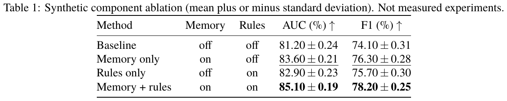

**重建 TeX:**

[重建 TeX](examples/public/basic-ablation/reconstruction.tex)

<!-- LOCAL-ONLY:BEGIN -->
#### 消融表格示例 1

**原图:**

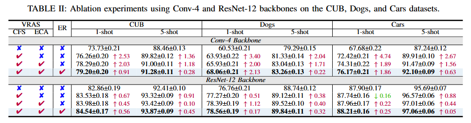

**原始 TeX:**

[原始 TeX](examples/references/ablation_table-example1/original.tex)

**Skill 重建结果:**

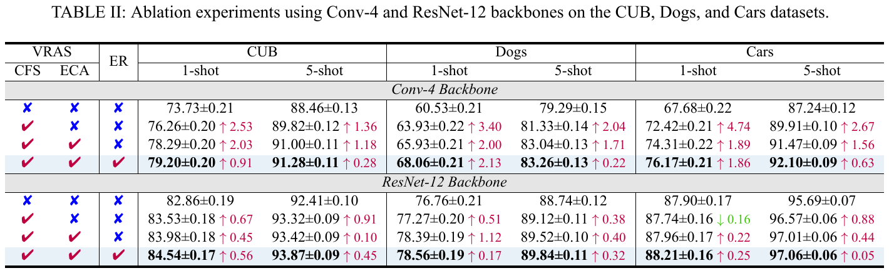

**重建 TeX:**

[重建 TeX](examples/references/ablation_table-example1/reconstruction.tex)

<!-- LOCAL-ONLY:END -->

<!-- LOCAL-ONLY:BEGIN -->
#### 消融表格示例 2

**原图:**

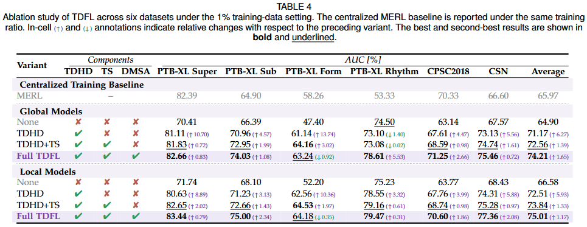

**原始 TeX:**

[原始 TeX](examples/references/ablation_table-example2/original.tex)

**Skill 重建结果:**

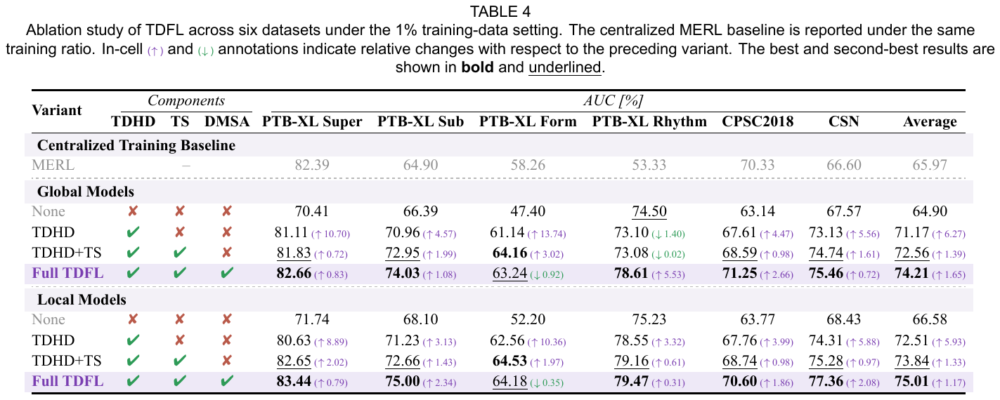

**重建 TeX:**

[重建 TeX](examples/references/ablation_table-example2/reconstruction.tex)

<!-- LOCAL-ONLY:END -->

<!-- LOCAL-ONLY:BEGIN -->
#### 表征消融

**原图:**

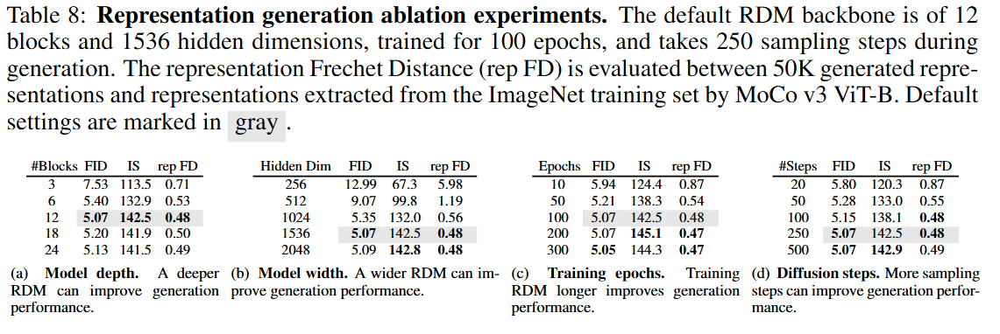

**原始 TeX:**

未提供原始 TeX

**Skill 重建结果:**

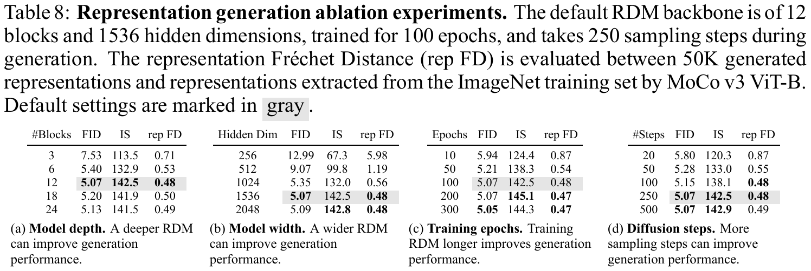

**重建 TeX:**

[重建 TeX](examples/references/representation-ablation/reconstruction.tex)

<!-- LOCAL-ONLY:END -->

<!-- LOCAL-ONLY:BEGIN -->
#### 数据混合消融

**原图:**

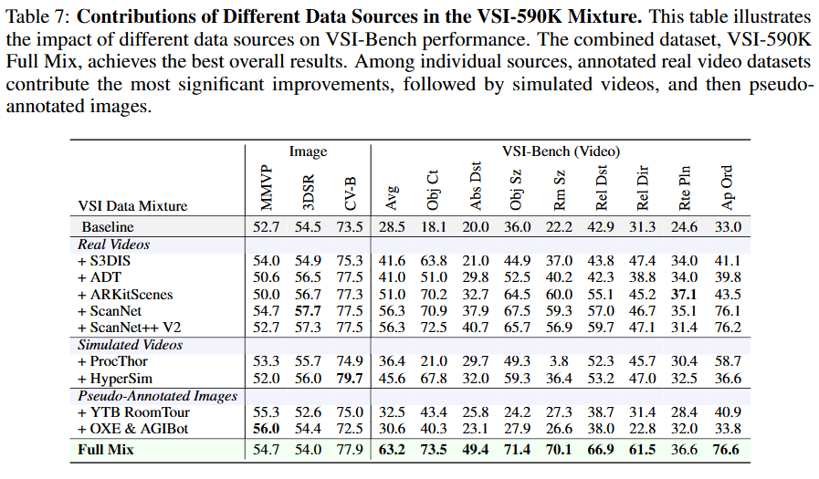

**原始 TeX:**

未提供原始 TeX

**Skill 重建结果:**

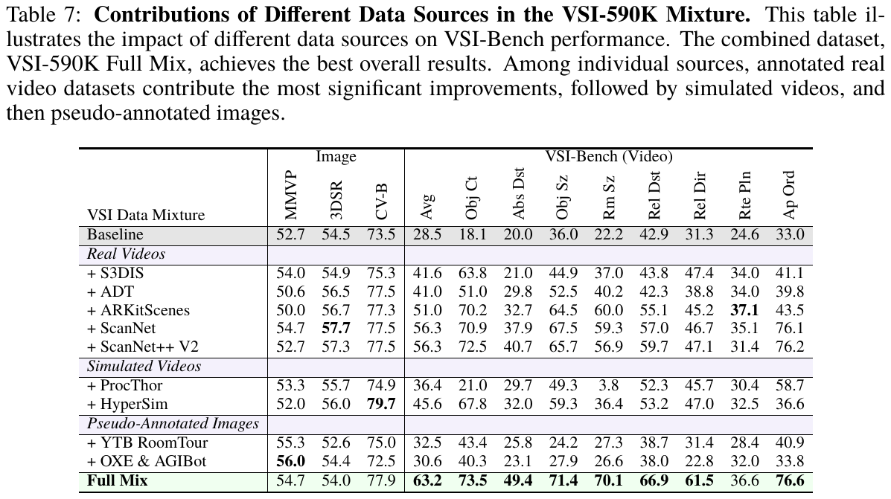

**重建 TeX:**

[重建 TeX](examples/references/data-mixture/reconstruction.tex)

<!-- LOCAL-ONLY:END -->

### Dataset Comparison & Capability Matrix

#### 公开跨数据集示例

**原图:**

未提供原图；此项为项目编写的合成示例。

**原始 TeX:**

未提供原始 TeX

**Skill 重建结果:**

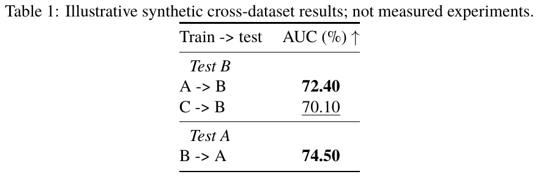

**重建 TeX:**

[重建 TeX](examples/public/public-cross-dataset/reconstruction.tex)

#### 公开多数据集示例

**原图:**

未提供原图；此项为项目编写的合成示例。

**原始 TeX:**

未提供原始 TeX

**Skill 重建结果:**

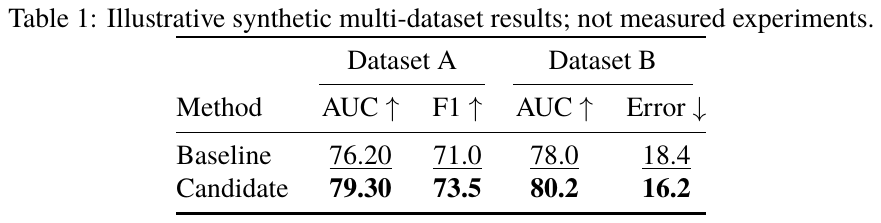

**重建 TeX:**

[重建 TeX](examples/public/public-multi-dataset/reconstruction.tex)

#### 数据集能力矩阵

**原图:**

未提供原图；此项为项目编写的合成示例。

**原始 TeX:**

未提供原始 TeX

**Skill 重建结果:**

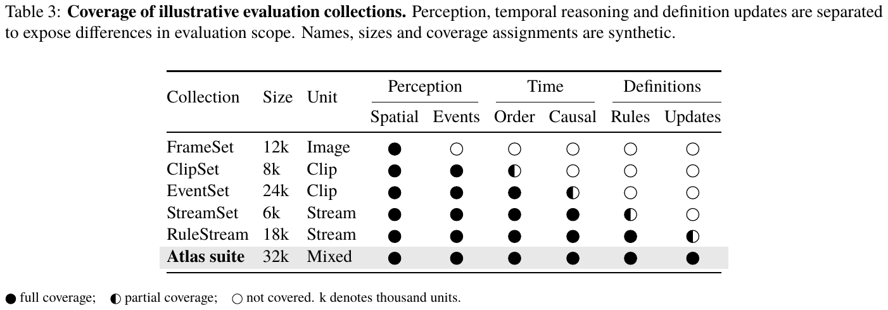

**重建 TeX:**

[重建 TeX](examples/public/showcase-coverage/reconstruction.tex)

<!-- LOCAL-ONLY:BEGIN -->
#### 数据集基准表

**原图:**

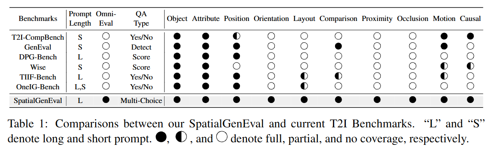

**原始 TeX:**

[原始 TeX](examples/references/dataset_benchmark_table/original.tex)

**Skill 重建结果:**

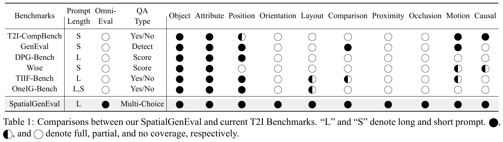

**重建 TeX:**

[重建 TeX](examples/references/dataset_benchmark_table/reconstruction.tex)

<!-- LOCAL-ONLY:END -->

<!-- LOCAL-ONLY:BEGIN -->
#### 相关数据集表

**原图:**

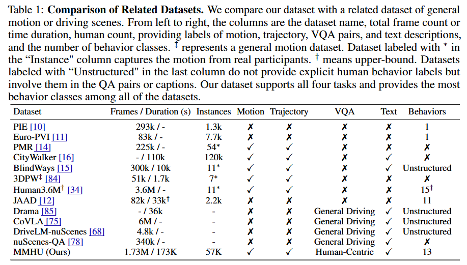

**原始 TeX:**

未提供原始 TeX

**Skill 重建结果:**

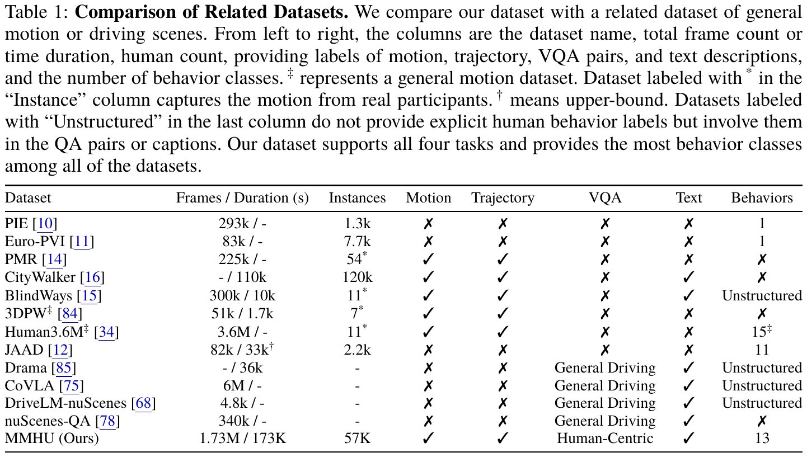

**重建 TeX:**

[重建 TeX](examples/references/related-datasets/reconstruction.tex)

Provenance: Original TeX not provided; caption claims not independently verified.

<!-- LOCAL-ONLY:END -->

### Human–Judge Evaluation

<!-- LOCAL-ONLY:BEGIN -->
#### 人工评审评估

**原图:**

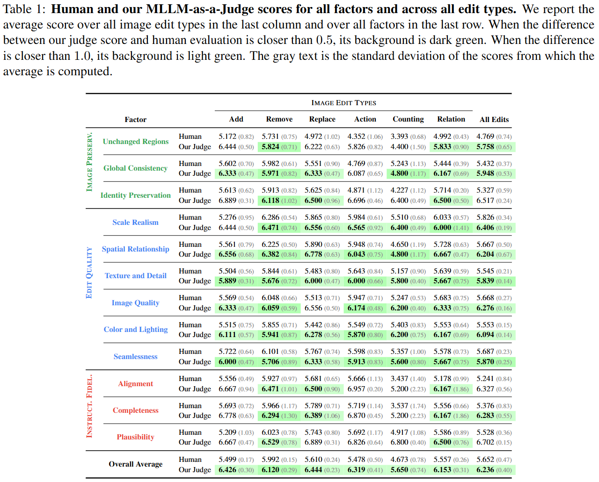

**原始 TeX:**

未提供原始 TeX

**Skill 重建结果:**

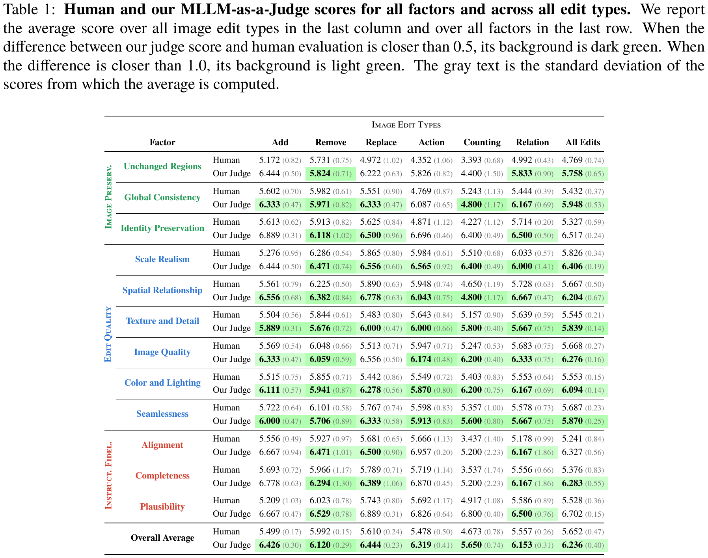

**重建 TeX:**

[重建 TeX](examples/references/human-judge/reconstruction.tex)

Provenance: Original TeX not provided; caption claims not independently verified.

<!-- LOCAL-ONLY:END -->

### Qualitative VQA

<!-- LOCAL-ONLY:BEGIN -->
#### 行为问答示例

**原图:**

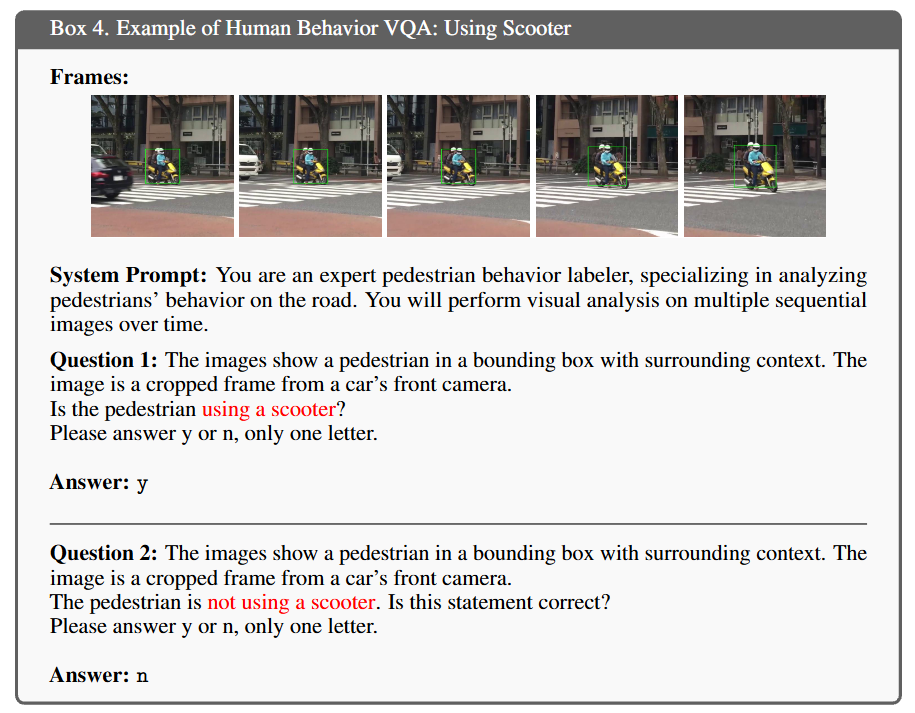

**原始 TeX:**

未提供原始 TeX

**Skill 重建结果:**

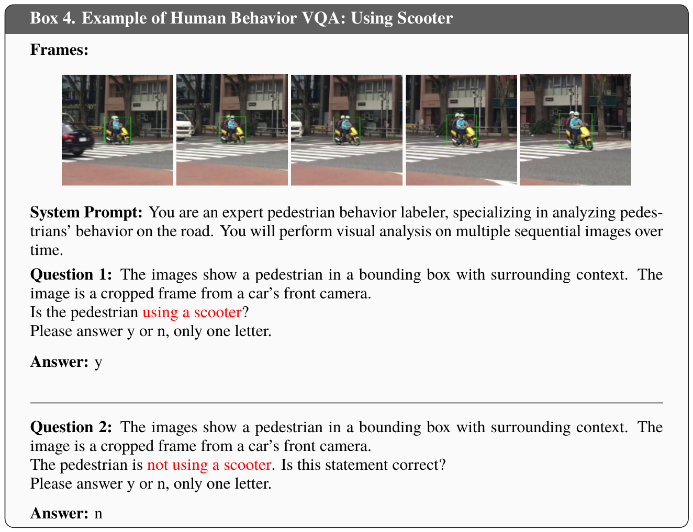

**重建 TeX:**

[重建 TeX](examples/references/behavior-vqa/reconstruction.tex)

Provenance: Original TeX not provided; caption claims not independently verified.

<!-- LOCAL-ONLY:END -->

### Algorithms & Protocols

<!-- LOCAL-ONLY:BEGIN -->
#### 协议示例 1

**原图:**

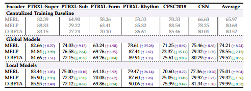

**原始 TeX:**

[原始 TeX](examples/references/others-example1/original.tex)

**Skill 重建结果:**

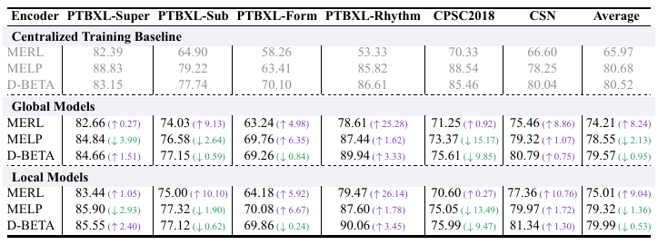

**重建 TeX:**

[重建 TeX](examples/references/others-example1/reconstruction.tex)

<!-- LOCAL-ONLY:END -->

<!-- LOCAL-ONLY:BEGIN -->
#### 协议示例 2

**原图:**

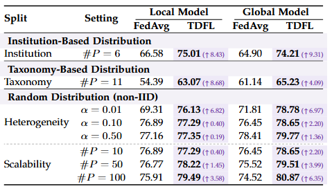

**原始 TeX:**

[原始 TeX](examples/references/others-example2/original.tex)

**Skill 重建结果:**

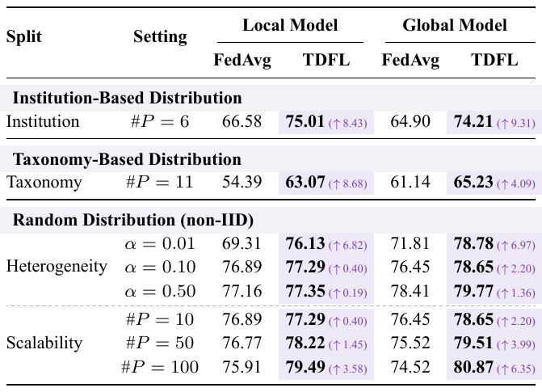

**重建 TeX:**

[重建 TeX](examples/references/others-example2/reconstruction.tex)

<!-- LOCAL-ONLY:END -->

<!-- LOCAL-ONLY:BEGIN -->
#### 协议示例 3

**原图:**

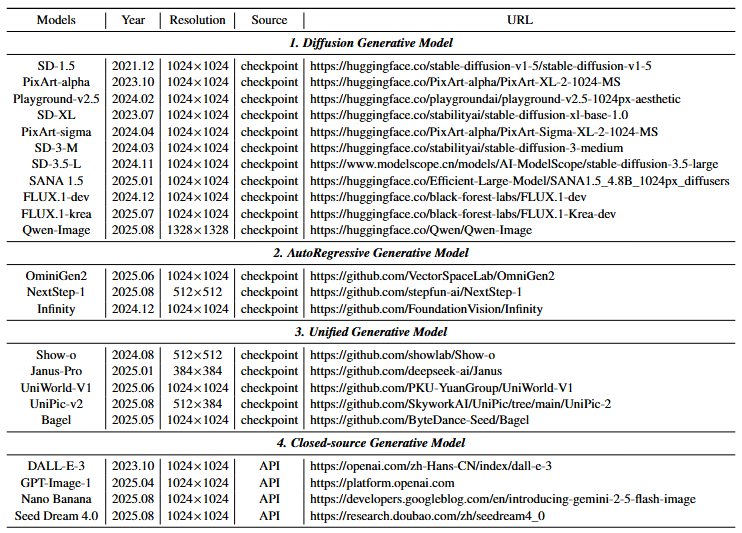

**原始 TeX:**

[原始 TeX](examples/references/others-example3/original.tex)

**Skill 重建结果:**

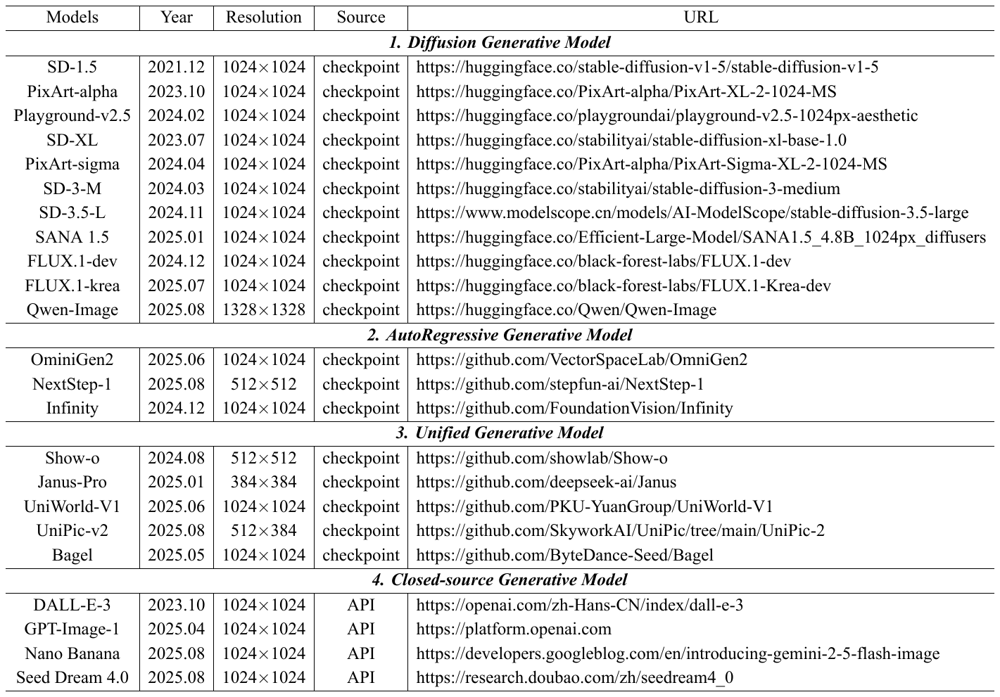

**重建 TeX:**

[重建 TeX](examples/references/others-example3/reconstruction.tex)

<!-- LOCAL-ONLY:END -->

<!-- LOCAL-ONLY:BEGIN -->
#### MeanFlow 算法

**原图:**

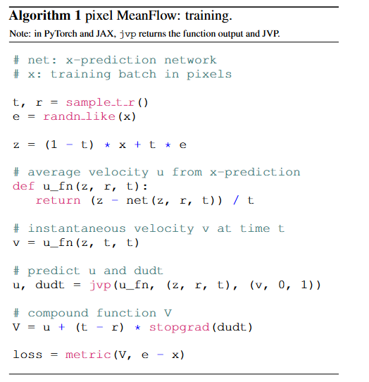

**原始 TeX:**

未提供原始 TeX

**Skill 重建结果:**

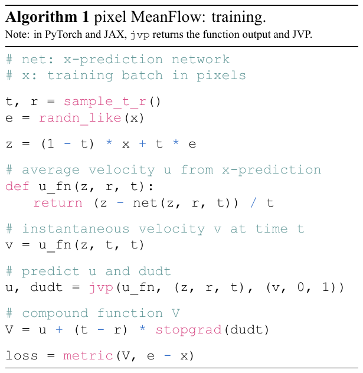

**重建 TeX:**

[重建 TeX](examples/references/meanflow-algorithm/reconstruction.tex)

<!-- LOCAL-ONLY:END -->

### Numerical Reporting & Refinement

#### 公开小数报告示例

**原图:**

未提供原图；此项为项目编写的合成示例。

**原始 TeX:**

未提供原始 TeX

**Skill 重建结果:**


**重建 TeX:**

[重建 TeX](examples/public/public-decimal/reconstruction.tex)

#### 公开并列与缺失值示例

**原图:**

未提供原图；此项为项目编写的合成示例。

**原始 TeX:**

未提供原始 TeX

**Skill 重建结果:**


**重建 TeX:**

[重建 TeX](examples/public/public-ties-missing/reconstruction.tex)

#### 公开不确定性报告示例

**原图:**

未提供原图；此项为项目编写的合成示例。

**原始 TeX:**

未提供原始 TeX

**Skill 重建结果:**


**重建 TeX:**

[重建 TeX](examples/public/public-uncertainty/reconstruction.tex)

#### 数值精化后

**原图:**


**原始 TeX:**

[原始 TeX](examples/public/refinement-after/original.tex)

**Skill 重建结果:**


**重建 TeX:**

[重建 TeX](examples/public/refinement-after/reconstruction.tex)

Provenance: Original image is a project-authored synthetic baseline, not an external source-paper image.

#### 分组设计复用

**原图:**


**原始 TeX:**

[原始 TeX](examples/public/reuse-grouped/original.tex)

**Skill 重建结果:**


**重建 TeX:**

[重建 TeX](examples/public/reuse-grouped/reconstruction.tex)

Provenance: Original image is a project-authored synthetic baseline, not an external source-paper image.

#### 紧凑设计复用

**原图:**


**原始 TeX:**

[原始 TeX](examples/public/reuse-compact/original.tex)

**Skill 重建结果:**


**重建 TeX:**

[重建 TeX](examples/public/reuse-compact/reconstruction.tex)

Provenance: Original image is a project-authored synthetic baseline, not an external source-paper image.

## 核心特点

| 特点 | 工作方式 |
| --- | --- |
| 参考驱动排版 | 先匹配论文参考的 caption、密度、字体角色、表头和强调，再适配数据；不添加海报式装饰。 |
| 数据保真 | 核对单元格身份、数值字符串、精度、不确定性和引用；代码与图片冲突时保留独立版本。 |
| 有依据的强调 | 显式指定指标方向、比较范围和并列规则；默认行、重点方法与最优值分别处理。 |
| 可编辑重建 | 恢复宏与依赖；图片先逐格转写，模糊值保留 [?]，不猜数字。 |
| 持续积累 | 保存私有待审案例和失败修复记录，供后续检索；稳定规则另经回归与审核。 |
| 分层验证 | 分别报告数据核对、静态检查、编译与渲染审阅，保留源码和证据。 |

## 三种输入方式

| 输入 | 工作方式 | 交付 |
| --- | --- | --- |
| 代码 + 图片 | 对照代码与原图，恢复宏和依赖，检查行列、数值、字体、粗斜体及强调标记 | TeX、依赖说明、冲突记录、实际编译与原图对比 |
| 仅代码 / 数据 | 保留原始字符串与精度，按目标版心生成或精修 | 可编辑 TeX、数据核对记录、PDF/PNG |
| 仅图片 | 先建立逐格转写记录；模糊字符保留 `[?]`，再重建表格 | TeX、图片哈希、转写状态及待确认清单 |

代码与图片可能来自不同版本。默认保留代码数据；如果需要按图复现，建立独立版本，不用修改数字来掩盖冲突。辅助脚本不是 OCR，也不能凭图片确认实验真实性。

## 已学习的布局

当前画廊按 7 类展示 **38 个独立示例**：17 个公开合成示例与 21 个私有参考示例；通过别名及基线关系保留全部 **41 个输入示例标识**。私有参考由原有 18 对 figure/TeX 对照及本次新增的 Related Datasets、Human–Judge、Behavior VQA 三例组成。缺少原始 TeX 的案例已逐项标注。公开合成画廊的 20 个输入条目合并为 17 个独立展示项，原有文件保留。历史参考的细节见[参考示例明细](references/example-details.md)，当前完整索引见[示例目录](docs/example-catalog.json)。原图与源码保持独立；源代码与截图冲突时保留两条分支。

| 布局 | 主要设计 | 关注细节 |
| --- | --- | --- |
| Few-shot 组件消融 | 9 列、3 个组件、两种 backbone、成对 shot 列 | 均值 ± 标准差、粗体最优行、斜体分组、增益箭头 |
| 多数据集组件消融 | 11 列、Global/Local 分组、淡色区块 | 粗体/下划线作用域、紫色完整方法、细字号注释 |
| 数据集能力矩阵 | 14 列、分层表头、覆盖圆点 | 实心/半实心/空心、图例与字号比例 |
| 空间能力主表 | 12 列、旋转列名、3 类指标 | Rank 原值、分组斜体、深浅灰强调 |
| Omni 模型主表 | 15 列、类别与难度分组 | 分组粗斜体、品牌图标、参数字符串 |
| 多领域工具主表 | 13 列、能力图标、标准差、双 Δ 列 | 小号灰色不确定性、下标、平均行 |
| Zero-shot 综合表 | 25 列源码 / 23 列图片 | 旋转彩色表头、平均列、版本冲突隔离 |
| 编码器比较 | 8 列、中心化/全局/局部分组 | 灰色基线、粗体正文、不同增益基准 |
| 联邦数据划分 | 6 列、Local/Global 成对比较 | 多行 setting、希腊字母、百分点变化 |
| 模型资源目录 | 5 列、按家族分组、长 URL | 粗斜体家族名、正文粗体、可编辑链接 |

详细经验见[参考目录](references/reference-catalog.md)。原始参考材料的再分发权尚未确认。当前完整私有仓库通过 `examples/references/` 展示对照，原始案例与记录保留在 `assets/cases/local/`；公开导出会排除这两类私有资产，并过滤 README 与索引，仅保留 17 个独立合成示例。参考来源中的实验主张未经独立核实；画廊展示实际重建与已知差异，不宣称像素完全一致。

## 安装到 Codex

在 Codex 中打开本仓库，发送：

```text
请将当前 paper-latex-table-skill 安装到我已配置的 Codex skills 目录。
如已存在，请先比较和备份，保留已有学习记录，安装后验证技能可发现。
```

手动安装（Windows PowerShell；从包含 SKILL.md 的仓库根目录执行）：

```powershell
$skillSource = (Resolve-Path .).Path
if (-not (Test-Path (Join-Path $skillSource 'SKILL.md'))) { throw '请在技能仓库根目录执行' }
$skillHome = if ($env:CODEX_HOME) { $env:CODEX_HOME } else { Join-Path $HOME '.codex' }
$skillTarget = Join-Path $skillHome 'skills/paper-latex-table-skill'
if (Test-Path $skillTarget) { throw '目标已存在，请先比较并备份再更新' }
New-Item -ItemType Directory -Force -Path $skillTarget | Out-Null
Get-ChildItem -LiteralPath $skillSource -Force |
    Where-Object { $_.Name -notin @('.git', '.local', 'build', 'state', 'skill-state', '__pycache__') } |
    ForEach-Object { Copy-Item -LiteralPath $_.FullName -Destination $skillTarget -Recurse }
```

安装后检查 Codex 的技能列表。若列表未刷新，重启客户端后在新一轮对话中输入 `$paper-latex-table-skill`。无需启用 OpenCode；它仅用于开发评审。

## 使用示例

```text
$paper-latex-table-skill 用 results.json 生成双栏论文通栏表；accuracy 越高越好，latency 越低越好。
$paper-latex-table-skill 按 figure.png 复现 table.tex，对齐字体、字号、粗体、斜体、下划线与间距，保留全部数值。
$paper-latex-table-skill 只有这张截图，请先逐格转写，再重建可编辑 LaTeX；看不清的值不要猜。
$paper-latex-table-skill 学习这份新表格，保存源代码/图片、设计参数与核对记录，作为待审阅参考。
```

命令行（输出应使用新文件/目录）：

```text
python scripts/index_cases.py
python scripts/generate_table.py docs/examples/benchmark.json build/demo.tex
python scripts/validate_table.py build/demo.tex --spec docs/examples/benchmark.json
python scripts/compile_table.py build/demo.tex --output build/demo-compile
python scripts/inspect_render.py build/demo-compile/table-build.pdf --output build/demo-render
python scripts/retrieve_cases.py --columns 9 --type ablation --feature grouped_headers
```

本地参考复现与图片转写的命令、格式和依赖见[输入流程](references/input-routes.md)。JSON 生成器支持一层分组表头；复杂 multirow、深层表头和专用宏由代理结合核对记录编写。

## 持续学习

新案例或真实修复经验会保存为私有 pending 记录，默认位于 `$CODEX_HOME/skill-state/paper-latex-table-skill`，不随技能更新覆盖。后续相关任务可以检索这些记录，复用经过核对的布局与修复方法。

稳定规则、脚本和案例晋升需经过回归、来源检查、实际渲染审阅及明确批准。这里的“自我进化”是可追溯的经验积累与受控改进，不是模型权重训练或后台自行改写。见[学习流程](references/continuous-learning.md)和[改进政策](rsi/improvement-policy.md)。

## 依赖与验证

- Python 3.10+；核心生成、校验、转写脚本仅用标准库。
- TeX 引擎与所需宏包；本地恢复案例使用 XeLaTeX、fontspec、TikZ 等。
- Poppler `pdftoppm` 用于 PDF 转 PNG；Pillow 为对比图/文档预览的可选依赖。
- 字体对齐分支优先使用本机 Times New Roman，缺少时回退 TeX Gyre Termes；截图无法提供确切字体元数据，推断和替代会写入记录。

数据核对、编译成功、视觉对应与投稿尺寸可读性分别报告。编译成功不等于视觉通过，也不代表符合任一会议官方模板。

## 公开打包

```text
python scripts/export_public.py .local/releases/paper-latex-table-skill-1.3.0.zip
```

导出排除私有参考、构建日志、学习状态、Git 历史与内部备份，保留公开示例、README 图片及可运行工具。项目许可证状态见 [LICENSE](LICENSE)；第三方参考不会自动继承项目许可。

README 目录与原图/复现画廊的组织参考了 [Trae1ounG/paper-plot-skills](https://github.com/Trae1ounG/paper-plot-skills)。开发中使用本机 OpenCode API 完成了一份文档与流程评审；运行本技能不依赖它。

## 三条 RSI 学习与复用流程

| 模式 | 如何学习 | 如何复用 |
| --- | --- | --- |
| Code + Figure | 原件快照 → 行列/数值/样式冲突核对 → 宏与字体恢复 → 编译对比 | 从已审阅版本提取布局参数；代码版与图片版分开 |
| Figure Only | 逐格转写 → 模糊值 `[?]` → 可编辑 TeX → 字体与粗斜体对照 | 保存图片哈希、转写与恢复经验；未确认值阻止晋升 |
| 设计复用 | 检索相近案例/历史失败 → 分解设计角色 → 基线 + 最多两个组合候选 | 同数据、同最小字号下比较；只保留经核对的参数组合 |

新增 `rsi_episode.py` 记录实际学习过程，`compose_designs.py` 生成并核对设计候选。当前自动组合范围为列间距、行距、分组斜体/粗斜体；复杂表头、配色和线型由 Codex 基于参考与核对记录编写。日常复用不需额外的全局升级批准；稳定规则与脚本晋升单独管理。详见[三模式教程与命令](references/three-rsi-loops.md)。
